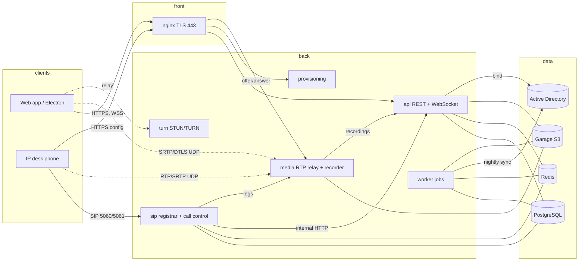
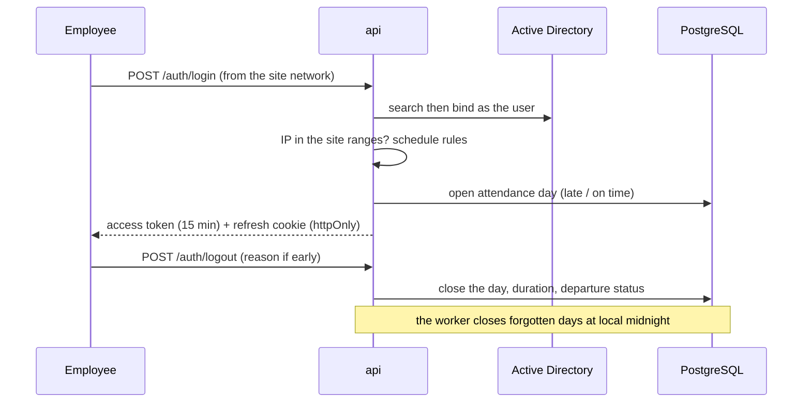
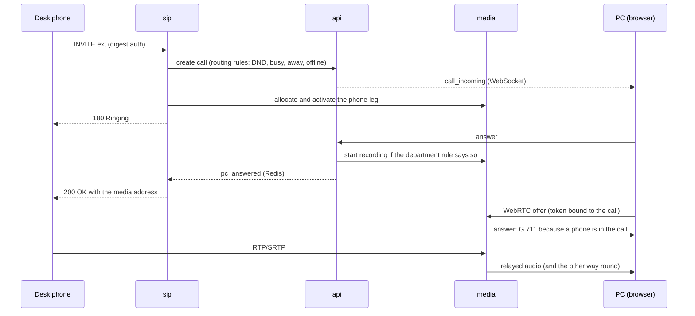

# Architecture

EximPhone runs entirely on Exim Bank servers: nothing depends on the Internet in production, and every business service (SIP, media, chat, presence, attendance) is our own code. Third-party software is limited to libraries (sipgo, pion, chi, pgx) and standard infrastructure (PostgreSQL, Redis, Nginx, an S3-compatible store).

## Services

Networks: `front` (nginx), `back` (services), `data` (database, Redis, object store; internal, never published). Only nginx publishes 443; `sip`, `media` and `turn` publish their signaling and UDP ranges because real-time media cannot go through an HTTP proxy.

## Attendance and sessions

Login is the arrival clock-in; without an open day no request is accepted. Presence is kept in Redis and pushed to every client over WebSocket through Redis pub/sub, so any `api` instance can serve any user.

## A call between a desk phone and a PC

If the callee also has desk phones, `sip` forks an INVITE to each; the first device to answer wins and the others receive CANCEL (phones) or stop ringing (PC).

## Data protection summary

| Data | Protection |
|---|---|
| Traffic | TLS 1.2+ everywhere (nginx, SIP over TLS, DTLS-SRTP for browsers, SRTP for phones) |
| Chat messages | AES-256-GCM per message, key outside the database (`MESSAGE_KEY`) |
| Attachments, recordings | AES-256-GCM objects in the store, key bound to the object id (`MESSAGE_KEY`, `RECORDING_KEY`) |
| SIP passwords | sealed (`SIP_KEY`), shown once at creation |
| Passwords of employees | never stored: Active Directory is the only authority |
| Audit journal | append-only (triggers), readable only by the auditor role, reads are audited |
| Backups | encrypted with a passphrase before leaving the server |

See `docs/adr/` for the reasons behind the main decisions and `docs/deployment.md` for operation.
