# Exim Connect — Features

*Overview for management, IT and business teams.*

---

## 1. In brief

**Exim Connect** is Exim Bank's **internal communication and attendance platform**. It replaces several separate tools with a single application, hosted **on the bank's own servers** (no data leaves the bank) and connected to its **corporate directory**.

| | |
|---|---|
| **Who uses it** | all employees, with the same credentials as their workstation |
| **Where** | in a web browser, in the Windows **PC application**, and on **desk IP phones** |
| **Languages** | French and English (one-click switch) |
| **Where the data lives** | at Exim Bank: database, files and recordings are encrypted |

Nine needs are covered in the same interface: **attendance, instant messaging, mail, telephony, video meetings, directory, announcements, tickets** and **HR dashboards**, with an **audit log** for compliance.

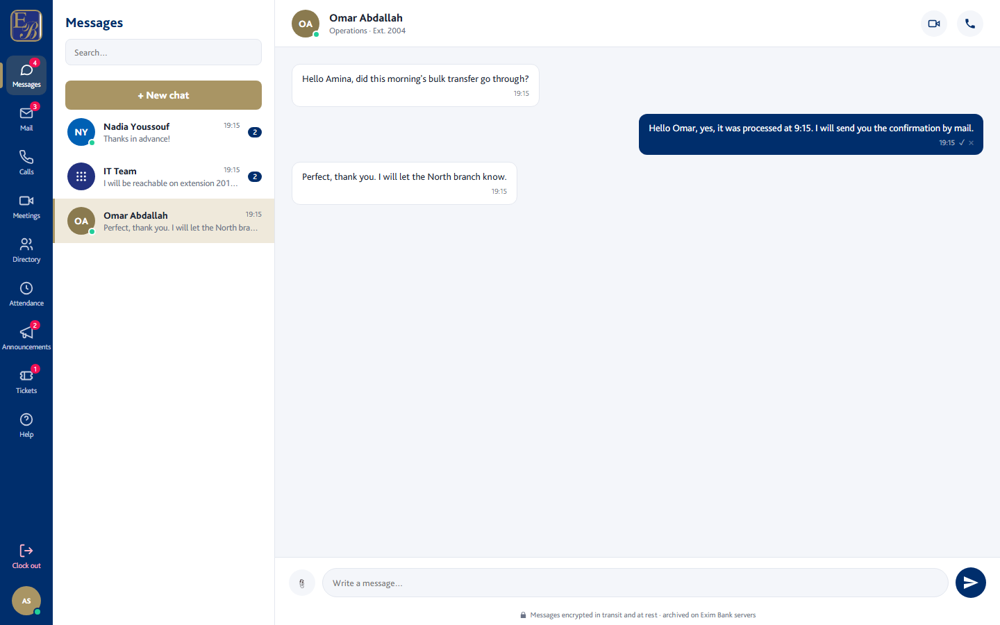

---

## 2. The modules

| Module | What it provides |
|---|---|
| **Attendance** | automatic clocking at sign-in / sign-out, rules for lateness and early departure |
| **Messages** | one-to-one and group chat, attachments, search, delivery indicators |
| **Mail** | complete internal e-mail **and sending/receiving to the outside** through the bank's mail server |
| **Calls** | telephony on the PC and on a **desk IP phone**, one internal number, encrypted recording |
| **Meetings** | video for up to 12 people, screen sharing, **remote control** |
| **Directory** | colleagues by department, extension, site, real-time status |
| **Announcements** | memos, urgent announcements with acknowledgement |
| **Tickets** | requests to services, approval by the head, assignment, follow-up |
| **Team / HR** | dashboards, approvals, corrections, payroll export |
| **Audit** | tamper-proof traceability log |
| **PC application** | one-click install from the site, secure remote control |

---

## 3. Feature details

### 3.1 Sign-in and attendance

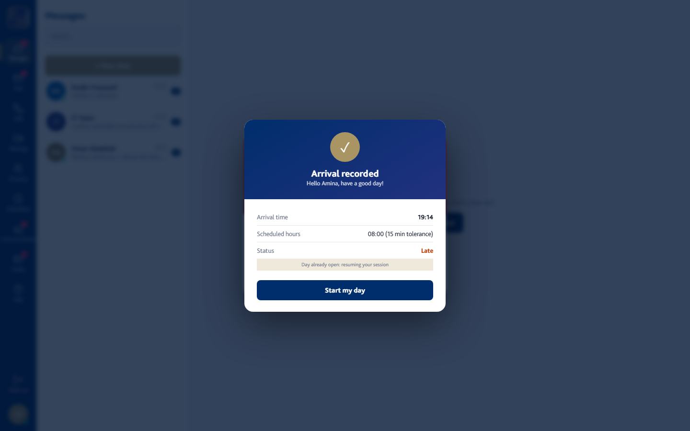

- **Authentication through the corporate directory** (Active Directory / LDAP): no new password.
- **Signing in is the arrival clock-in**, and signing out is the departure clock-in, after a confirmation window.
- **Network check**: clocking in is only accepted from the **IP ranges of the employee's branch** (configurable per site; switched off during the test phase).
- **Lateness**: arrival after start time + tolerance (default 08:00 + 15 min).
- **Early departure**: before the end time (default 17:00) a **mandatory reason** is requested and approved by the manager.
- **Forgotten clock-out**: the day is closed automatically at midnight, with the time of the last activity, and reported to the manager.
- **One clock-in per day**, whatever the number of devices.
- Time zone and working hours **per site**.

### 3.2 Instant messaging

- **One-to-one and group** chats, in **real time**.
- **Attachments**, history search, logical deletion of messages.
- Visible presence (online, busy, in a meeting, away, do not disturb).
- Messages **encrypted in transit and at rest**.

### 3.3 Mail

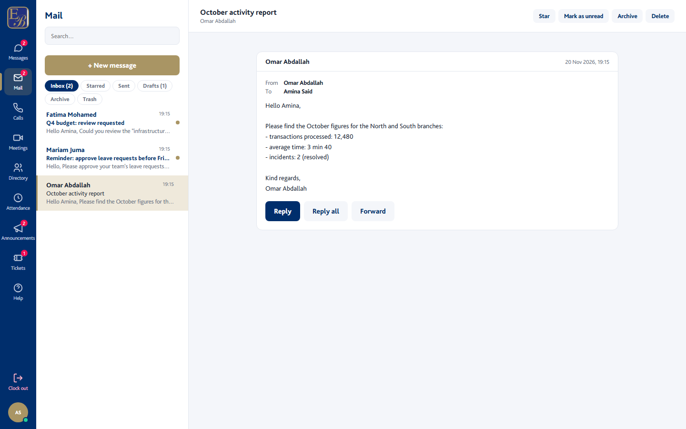

- **To, Cc, Bcc** with directory autocomplete; **drafts** saved automatically; **conversations** (threads).
- **Reply, reply all, forward** (with attachments).
- Folders **Inbox, Starred, Sent, Drafts, Archive, Trash**; search; real-time notifications.
- **Attachments**: up to 10 files of 20 MB (25 MB per message); executables and scripts refused.
- **External mail**: write to an outside address and **receive** replies, through the bank's existing mail server (optional, see the roadmap).
- Subject and body **encrypted at rest**; plain-text messages (no risk of scripts or tracking pixels).

### 3.4 Telephony

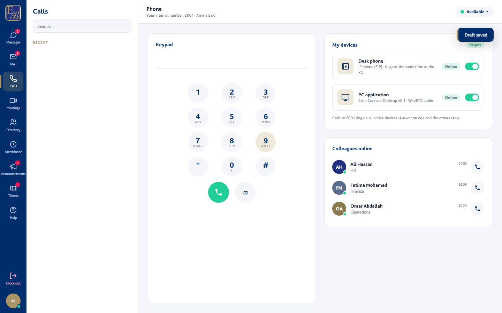

- Calls **from the PC** (browser or application) and from a **desk IP phone**, which **ring at the same time**.
- **One internal number** per person, whatever the device.
- Calls **between colleagues** of the bank (connection to a telephone operator is not included: see the roadmap).
- **Encrypted recording** of calls, with a configurable retention period (365 days by default) and logged access.
- IP phones are **configured automatically** (provisioning).

### 3.5 Video meetings, screen sharing and remote control

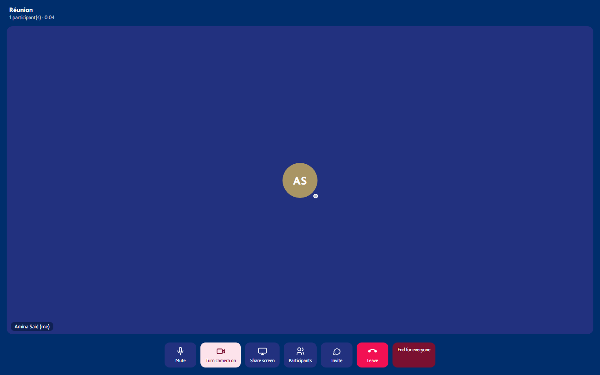

- **Meetings of up to 12 participants** and **one-to-one video calls** from a chat.
- **Screen sharing** (whole screen or a window).
- **Remote control**: a participant can drive a colleague's screen. See the box below.
- Video handled by the **bank's own server** (no outside service).

> **Remote control: secure by design**
> - only the **whole screen**, shared from the **PC application**, can be controlled;
> - a **native window** asks for the person's agreement, which a web page can neither validate nor imitate;
> - a **permanent red banner** and a **stop shortcut** (Ctrl+Alt+Shift+X) stay within reach of the controlled person;
> - the session stops **by itself after one hour** or as soon as sharing stops;
> - the Windows key, the lock screen and Ctrl+Alt+Delete are **never** transmitted;
> - every start and end of a session is **traced** in the audit log.

### 3.6 Directory and status

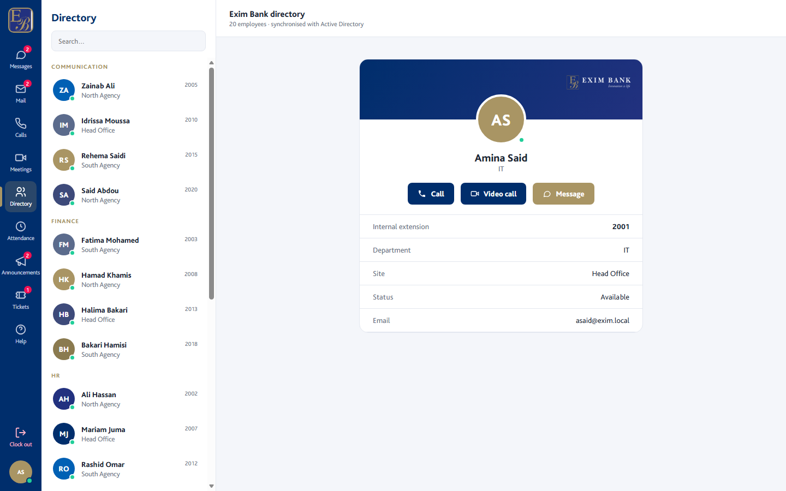

Employees by department, with **extension**, **site** and **status** (available, busy, in a meeting, away, do not disturb). From a card: **call, message, start a video call**. The status controls how calls ring.

### 3.7 Announcements

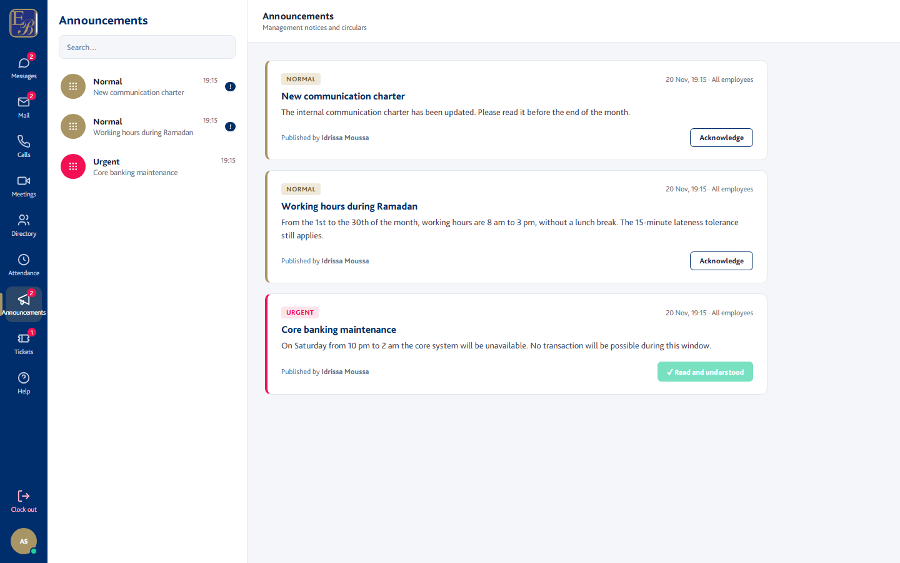

- Published by **communication** or **management**, to everybody, a department or a site.
- **Urgent announcements**: window displayed **until acknowledged**, even after a reconnection.
- **Read tracking**: who has read, who has not.

### 3.8 Tickets: requests to services

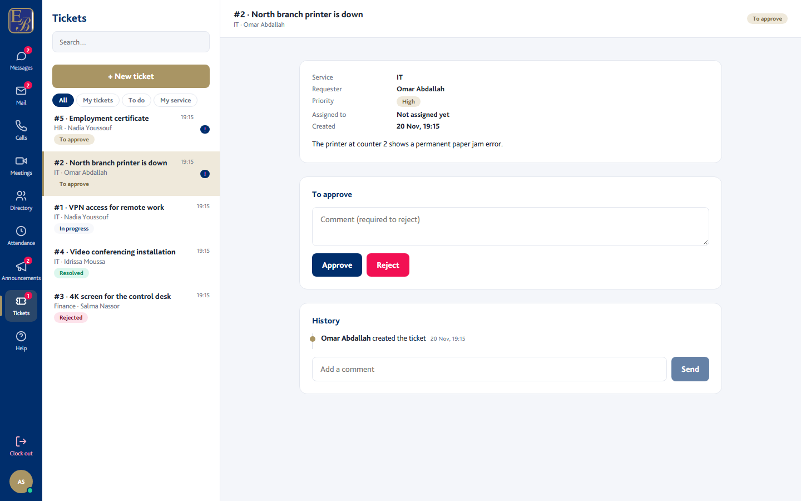

Complete workflow: **request → approval by the head of the service → assignment to a member → handling → resolution**.

- Statuses: to approve, approved, rejected, assigned, in progress, resolved, cancelled.
- **Complete history** (who did what, when, with which comment), real-time notifications.
- A **rejection** always requires a comment.
- Filters: my tickets, to do, my service.

### 3.9 Team: HR and manager dashboards

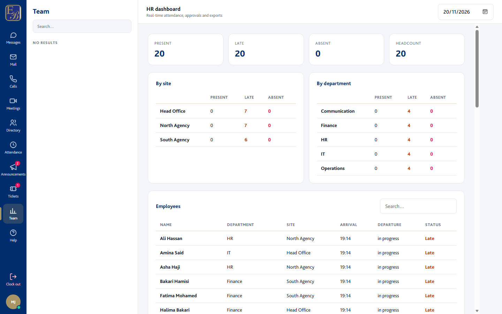

- **Present, late, absent** by site and by department, in real time.
- A **manager** sees their team; **HR** sees the whole bank.
- **Approval of early departures**, **justified attendance corrections** (the previous value is kept).
- **Monthly payroll export**: Excel (detail and per-employee summary) and CSV; protected against formula injection.

### 3.10 Audit and traceability

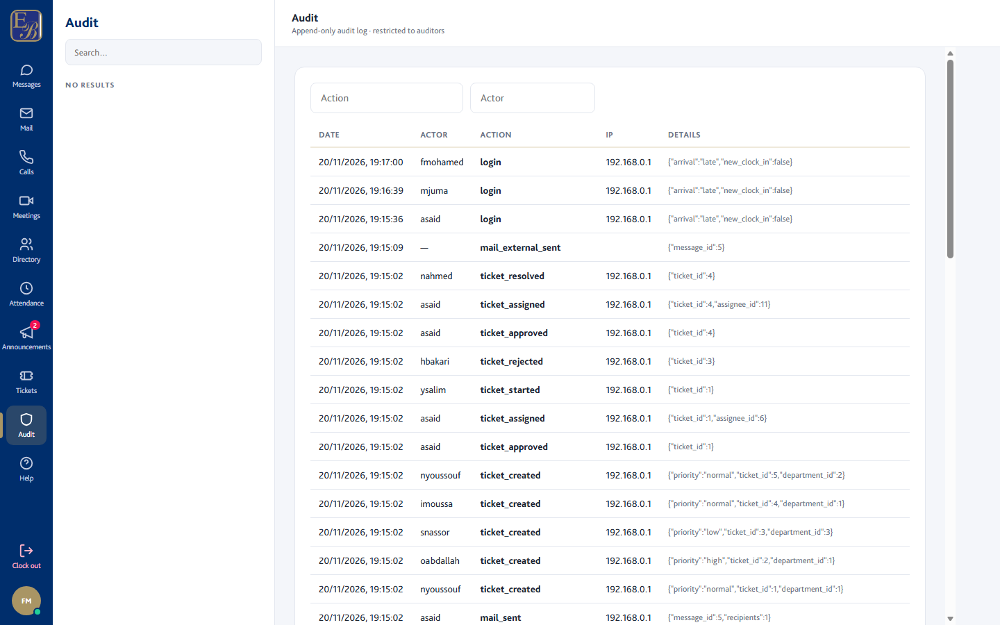

An **append-only** log that cannot be modified or erased (enforced by the database). It records: sign-ins and failures, network refusals, sign-outs, role changes, attendance corrections, HR exports, announcement publications, mail sent (without content), start and end of remote control. **Every consultation of the log is itself traced.**

### 3.11 PC application and help

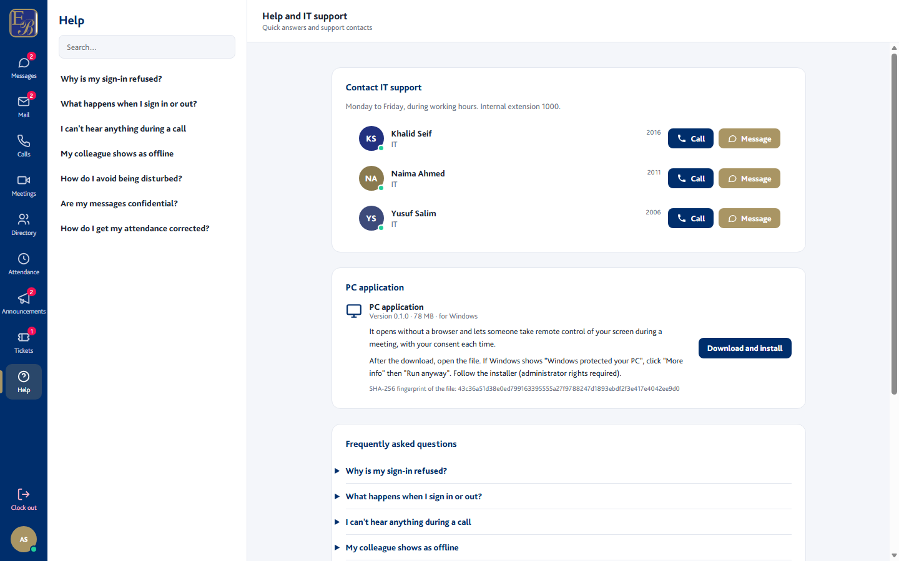

- **One-click install** from the site (profile menu or Help page), with the file's **SHA-256 fingerprint** for verification.
- **Help** page: IT support contacts, frequently asked questions, download.

---

## 4. Roles and permissions

Every user is an **employee**. Other roles are granted by the **IT administrator** and take effect immediately.

| Role | Can additionally |
|---|---|
| **Employee** | clock in, write, call, meetings, mail, tickets, read and acknowledge announcements |
| **Manager** | see their team, approve their team's early departures |
| **HR** | see everybody, approve early departures, correct clock-ins, export payroll, follow announcement read receipts |
| **Communication / Management** | publish announcements and follow who has read them |
| **Head of service** | approve or reject their service's tickets, assign them |
| **IT administrator** | manage roles, managers, sites (IP ranges, hours, tolerance), phones |
| **Auditor** | consult the audit log |

Safeguards: an administrator cannot remove their own role; a manager cannot approve their own early departure; the requester of a ticket cannot approve it.

---

## 5. Security and compliance

| Area | Measure |
|---|---|
| **Hosting** | on the bank's servers, no data with a third party |
| **Authentication** | corporate directory, short-lived access tokens, permissions re-read on every request |
| **Network** | access filtered by IP range per branch; sign-in rate limiting |
| **Encryption in transit** | TLS everywhere (HTTPS, secure WebSocket, encrypted media) |
| **Encryption at rest** | messages, mail, attachments and recordings in AES-256-GCM, keys kept apart from the database |
| **Traceability** | append-only audit log, consultations traced |
| **Attachments** | executables and scripts refused, downloads forced |
| **Remote control** | native consent, banner, immediate stop, time limit, logging |
| **Backups** | encrypted backup script (database and files), restore test provided; the daily schedule still has to be set up in production |
| **Quality** | more than 230 automated end-to-end tests, plus unit tests of the services and of the PC application |

---

## 6. Architecture in brief

The application runs as **containers** on a Linux server:

| Component | Role |
|---|---|
| **nginx** | single entry point, HTTPS, web site, rate limits |
| **api** | business logic: attendance, messages, mail, tickets, announcements, HR |
| **media** | audio/video of calls and meetings, screen sharing |
| **sip** | telephony, IP phones |
| **turn** | network traversal for calls |
| **provisioning** | automatic configuration of IP phones |
| **worker** | scheduled tasks (closing forgotten days, directory sync, recording retention) |
| **PostgreSQL / Redis** | data and real time |
| **Object storage** | encrypted attachments and recordings |
| **Directory** | the bank's Active Directory / LDAP |

The **PC application** is a Windows application (Electron) that displays the same site, with remote control added.

---

## 7. Deployment

- **Test environment**: deployed on a dedicated server, with a test certificate and a fictitious directory, to validate with a few users.
- **Production**: certificate from the bank's internal authority, real directory (LDAPS), real IP ranges, existing mail server, scheduled backups. The list of steps is in the **roadmap**.
