# Exim Connect — Technical Guide

*Technologies, architecture, diagrams, quality process and Git workflow. For developers, IT operations and security reviewers.*

---

## 1. Design principles

| Principle | What it means in practice |
|---|---|
| **On-premises, nothing outside** | Everything runs on the bank's servers. Business services (SIP, media, chat, attendance, mail, tickets) are our own code; third-party software is limited to libraries and standard infrastructure. |
| **One codebase, one image recipe** | A single Go module builds every back-end service from one shared multi-stage Dockerfile; images are minimal (*distroless*, non-root). |
| **Configuration by environment** | No secret in the code. Everything comes from `.env` (twelve-factor); compose override files select dev, test or production. |
| **Security by default** | TLS everywhere, application-level encryption at rest, append-only audit, least-privilege roles read on every request, explicit consent for remote control. |
| **Boring, auditable technology** | PostgreSQL, Redis, nginx, WebRTC/SIP standards. No exotic dependency; the few libraries are well known and pinned. |
| **Everything tested end to end** | Each feature ships with an acceptance script run against the real stack (§ 10). |

---

## 2. Technologies used

### 2.1 Overview by layer

| Layer | Technology | Version | Role |
|---|---|---|---|
| **Web client** | React | 18.3 | user interface |
| | TypeScript | 5.6 | typed code |
| | Vite | 5.4 | build and dev server |
| | Zustand | 4.5 | client state (chat, mail, meetings, tickets…) |
| | TanStack Query | 5.59 | server data fetching and cache |
| | Vitest | 2.1 | unit tests |
| **Desktop app** | Electron | 33 | Windows shell around the web app |
| | electron-builder | 25 | Windows installer (NSIS) |
| | koffi | 3 | calls to Windows `user32` (mouse and keyboard injection) |
| | Node test runner | built in | remote-control unit tests |
| **Back end** | Go | 1.23 | all services |
| | chi | 5.1 | HTTP routing |
| | pgx | 5.7 | PostgreSQL driver |
| | go-redis | 9.7 | Redis client |
| | coder/websocket | 1.8 | WebSocket (real time, meeting signalling) |
| | golang-jwt | 5.2 | access tokens |
| | go-ldap | 3.4 | Active Directory / LDAP |
| | minio-go | 7.0 | S3 client (object store) |
| | excelize | 2.8 | Excel export (attendance) |
| | go-imap / go-message | 1.2 / 0.18 | incoming and outgoing external mail |
| **Telephony** | sipgo | 0.27 | SIP registrar and call control |
| **Media** | pion/webrtc | 4.0 | WebRTC, SFU for meetings |
| | pion/turn, srtp, rtp, rtcp, interceptor | 4.0 / 3.0 / 1.8 / 1.2 / 0.1 | TURN, SRTP, RTP, feedback |
| **Data** | PostgreSQL | 16 | main database |
| | Redis | 7 | presence, real-time events (pub/sub), sessions |
| | Garage | 1.0 | S3-compatible object store (attachments, recordings) |
| | golang-migrate | 4.17 | forward-only SQL migrations |
| **Infrastructure** | Docker + Compose | 24+ / v2 | packaging and orchestration |
| | nginx | 1.27 | TLS, reverse proxy, web site, rate limiting |
| | Alpine / distroless | 3.20 / debian12 | base images |
| **Quality** | GitHub Actions | — | continuous integration |
| | golangci-lint, `go vet` | — | static analysis |
| | Trivy | 0.28 action | image vulnerability scan |
| | GreenMail | — | mail server simulation (dev and e2e) |

### 2.2 Protocols and cryptography

| Domain | Standard |
|---|---|
| Web | HTTPS (TLS 1.2+), HTTP/1.1, secure WebSocket (WSS) |
| Directory | LDAP / LDAPS (bind as the user to verify the password) |
| Real-time audio and video | WebRTC (ICE, DTLS-SRTP), VP8 video, Opus audio |
| Telephony | SIP over UDP/TCP/TLS, RTP/SRTP, G.711 between PCs and phones |
| NAT traversal | STUN / TURN |
| Mail | SMTP (STARTTLS / TLS), IMAP, MIME (UTF-8) |
| Encryption at rest | AES-256-GCM (messages, mail, attachments, recordings, SIP secrets) |
| Backups | AES-256 with PBKDF2-derived key |
| Tokens | JWT (15-minute access token, HttpOnly refresh cookie; 2-minute meeting token; 60-second single-use sign-in code for the PC application) |

---

## 3. Logical architecture

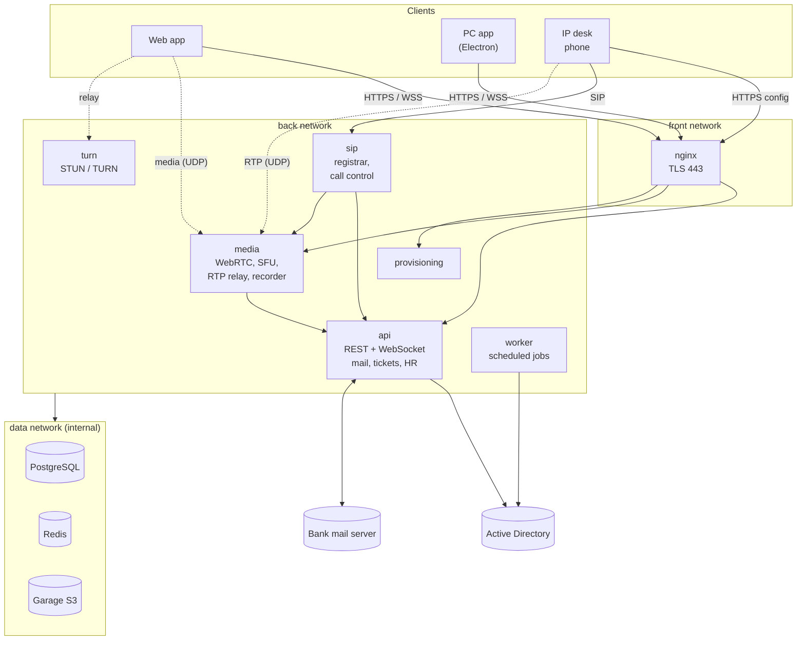

### 3.1 The services

| Service | Language / library | Listens on | Responsibility |
|---|---|---|---|
| **nginx** | nginx 1.27 | 443 (public) | TLS, web site (built React app), reverse proxy, login/API rate limits, installer download |
| **api** | Go, chi | 8080 (internal) | authentication, attendance, chat, mail (internal and external), tickets, announcements, HR, audit, meeting invitations; WebSocket events |
| **media** | Go, pion | 8080 + UDP 10000-10200 | WebRTC for PC calls, SFU for meetings (up to 12), RTP relay for phones, recording, screen sharing, remote-control routing |
| **sip** | Go, sipgo | 5060 / 5061 | SIP registrar and call routing (DND, busy, away, forking to several devices) |
| **turn** | Go, pion/turn | 3478, 49152-49200/udp | relay when UDP to `media` is blocked |
| **provisioning** | Go | 8080 (internal) | automatic configuration of IP phones |
| **worker** | Go | — | closing forgotten days at midnight, nightly directory sync, recording retention purge, bootstrap of roles and heads of service |
| **postgres / redis / garage** | — | internal only | data, real time, objects |

> Outgoing and incoming **external mail** (SMTP relay queue, IMAP poller) run inside the `api` service. **Backups** are a script (`scripts/backup.sh`), not a service.

### 3.2 Network zones and exposed ports

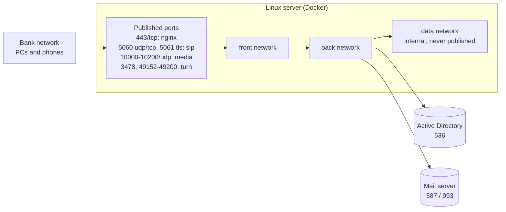

Only `nginx` is reachable over HTTP. `postgres`, `redis` and `garage` live on an **internal** network: they have no route to the outside and are not published. Real-time media cannot go through an HTTP proxy, which is why `sip`, `media` and `turn` publish their own port ranges.

---

## 4. Main flows

### 4.1 Sign-in is the clock-in

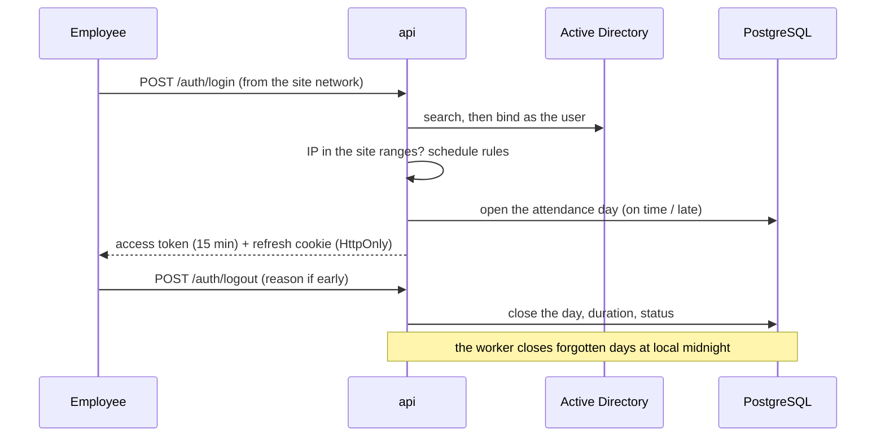

Passwords are never stored: Active Directory is the only authority.

### 4.1 bis Automatic sign-in of the PC application (one-time code)

```mermaid
sequenceDiagram
  participant W as Site (browser, signed in)
  participant A as api
  participant R as Redis
  participant OS as Windows
  participant D as PC application
  W->>A: POST /auth/desktop-code (open session)
  A->>R: SET dc:hash(code) = user, 60 s
  A-->>W: code (43 characters, 256 bits)
  W->>OS: opens eximconnect://signin?code=...
  OS->>D: starts or notifies the application (second-instance)
  D->>A: loads the site on ITS OWN configured address with ?desktop_code=...
  A->>R: GETDEL (single use)
  A->>A: active user? work day open?
  A-->>D: access token + HttpOnly refresh cookie
  Note over A,D: no new clock-in; every failure answers 401 without detail
```

The link carries **only** the code; the server address always comes from the application's own settings, never from the link. The code is stored hashed, lasts 60 seconds and works once. The reverse direction exists: the application opens the browser on `/?desktop_login=1`, and the site, once signed in, hands the session back to the application through the same mechanism.

### 4.2 Real-time events (chat, mail, tickets, announcements)

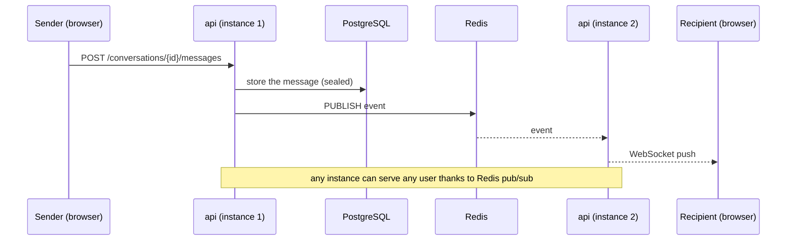

### 4.3 A call between a desk phone and a PC

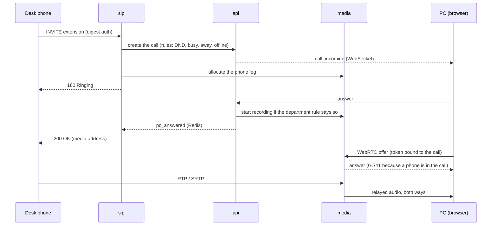

### 4.4 A video meeting (SFU)

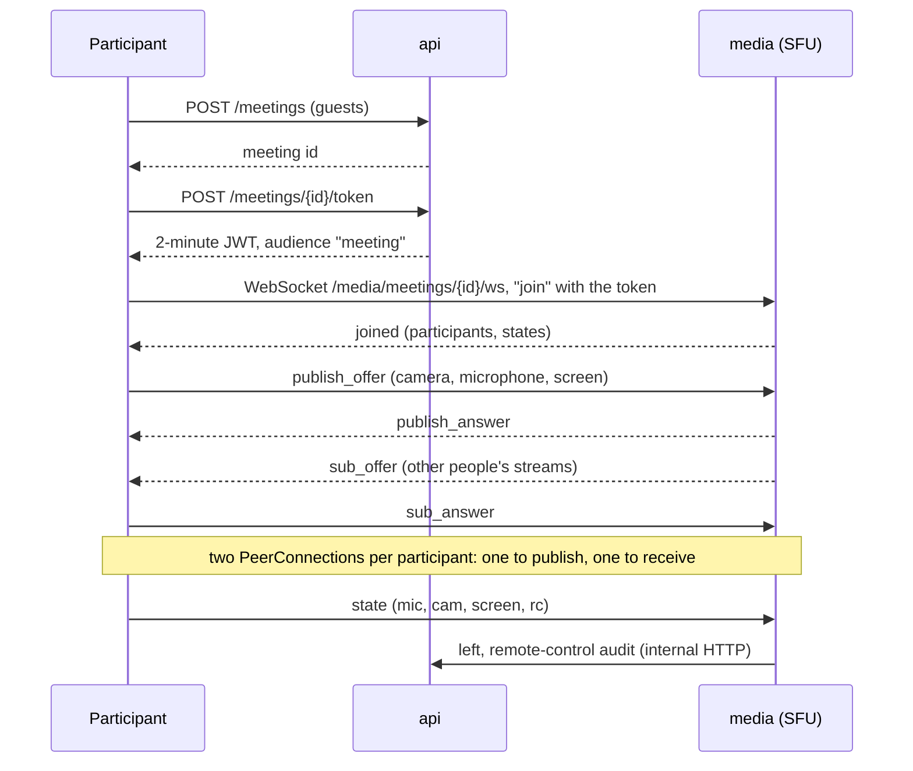

Each participant sends **one** copy of their streams; the SFU forwards them to the others (no mixing). Streams are named `<user>:<cam|screen>`.

### 4.5 Remote control of a shared screen

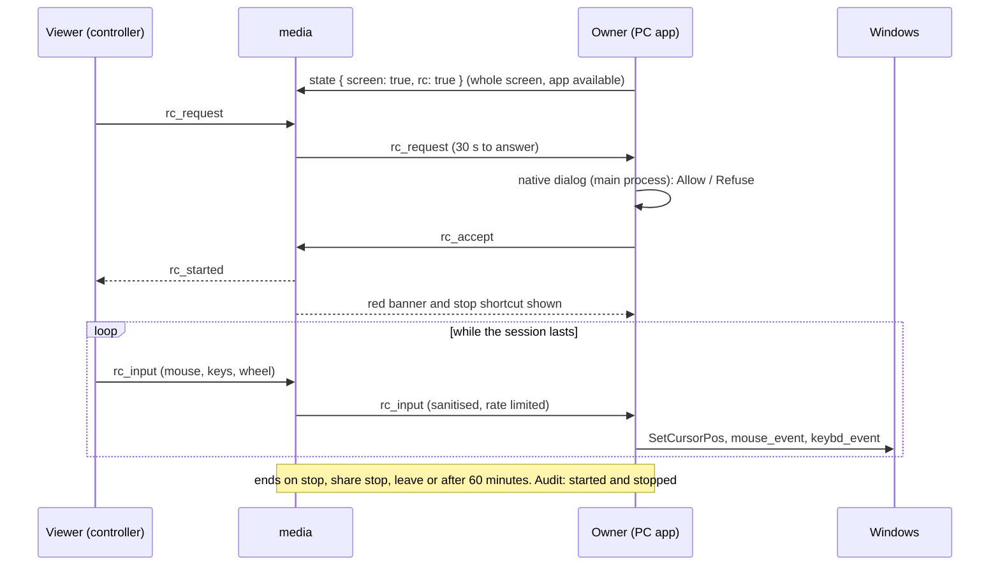

Input only flows **controller → owner**, only during an accepted grant, and is clamped (coordinates 0..1, limited rate, Windows key blocked).

### 4.6 External mail

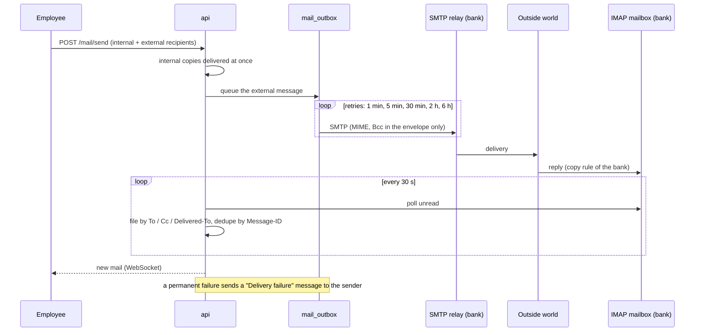

### 4.7 Ticket life cycle

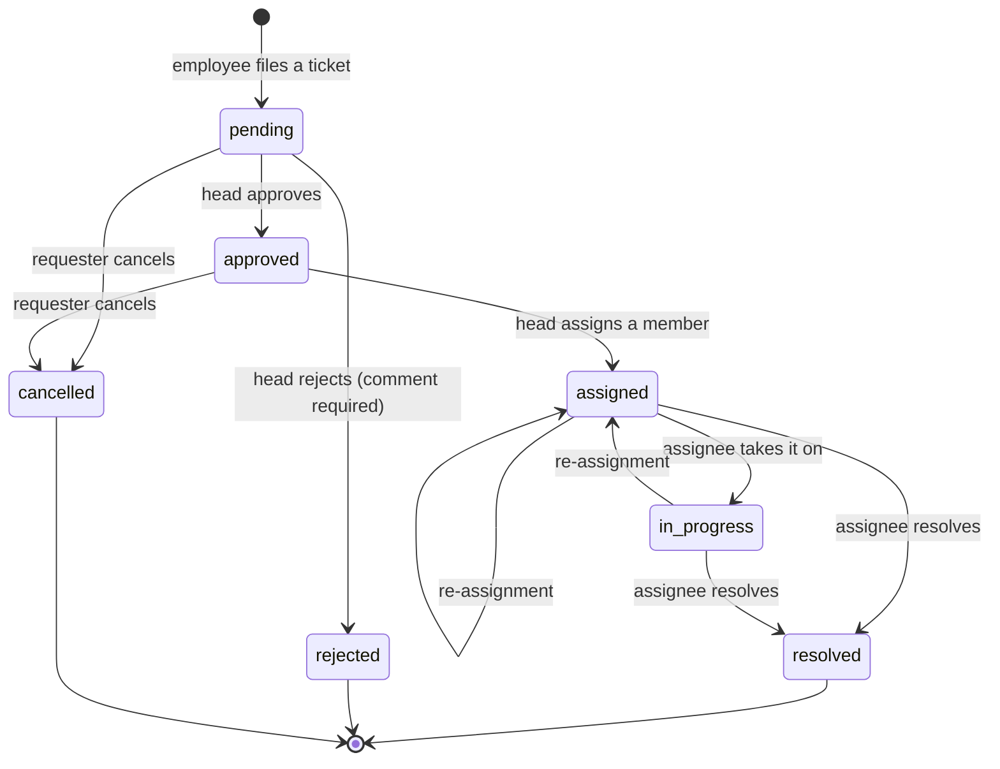

---

## 5. Data

### 5.1 Entity model (main tables, by domain)

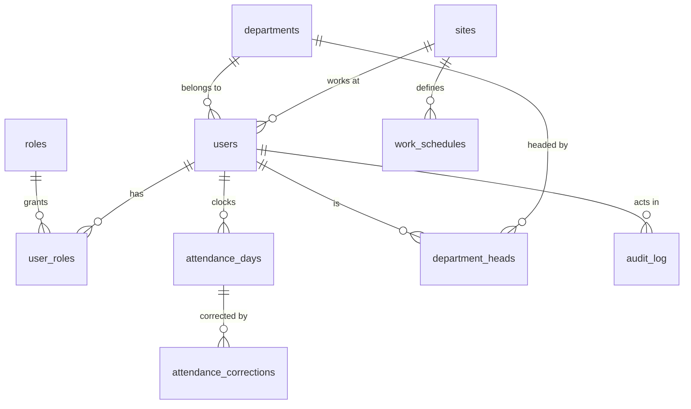

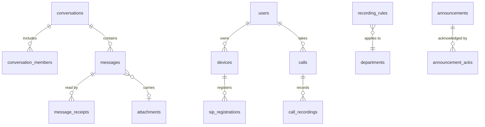

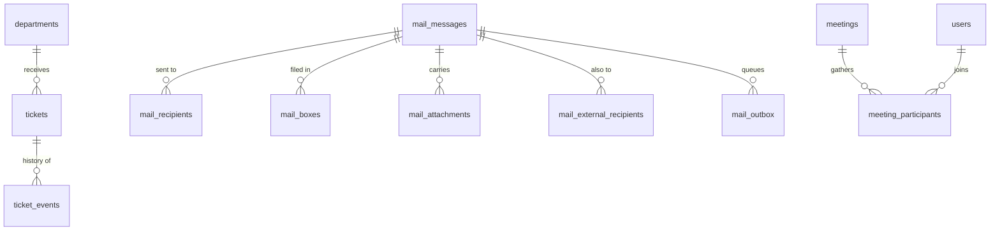

Twelve forward-only migrations (`db/migrations/000001_init` … `000012_meetings`) build the schema: initial users and sites, attendance, chat, calls, SIP, devices, announcements and HR, recording, tickets, mail, external mail, meetings.

### 5.2 Protection of data

| Data | Where | Protection |
|---|---|---|
| Employee passwords | nowhere | not stored (Active Directory) |
| Chat messages | PostgreSQL | AES-256-GCM per message, key `MESSAGE_KEY` outside the database |
| Mail subject and body | PostgreSQL | AES-256-GCM, bound to the message id |
| Attachments, recordings | Garage | AES-256-GCM objects, keys `MESSAGE_KEY` / `RECORDING_KEY` |
| SIP secrets | PostgreSQL | sealed with `SIP_KEY`, shown once |
| Audit journal | PostgreSQL | append-only (triggers reject UPDATE / DELETE / TRUNCATE) |
| Backups | off-server copy | encrypted with a passphrase before leaving the server |

---

## 6. Environments

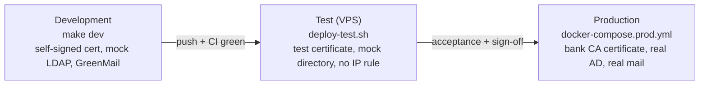

| | Development | Test (VPS) | Production |
|---|---|---|---|
| Start | `make dev` | `sh scripts/deploy-test.sh <ip>` | `docker compose -f docker-compose.yml -f docker-compose.prod.yml up -d --build --wait` |
| Compose files | base + `dev` | base + `test` | base + `prod` |
| Directory | `ldap-mock` (20 demo users) | `ldap-mock` (generated passwords) | bank Active Directory over LDAPS |
| Mail | GreenMail | none / relay if provided | bank SMTP relay + IMAP mailbox |
| Certificate | self-signed (`make certs`) | self-signed or public | bank internal CA |
| Network rule | local ranges | **none** (`ENFORCE_SITE_NETWORK=false`, testers connect from anywhere) | real branch ranges, rule on |
| Secrets | `.env.example` values | `gen-env.sh` random values | vault, replaced before start |

The **PC application** is built with `scripts/build-desktop.ps1 -Url <server>` (optionally `-PinServerCertificate` for a self-signed test server) and published to `downloads/` with a `manifest.json` (version, size, SHA-256); the site offers it from the profile menu and the Help page.

---

## 7. Quality process

### 7.1 Test pyramid

| Level | Tool | Volume | What it checks |
|---|---|---|---|
| Unit (Go) | `go test -race` | 16 test files | attendance rules, crypto, SIP auth, SFU and remote-control logic, mail parsing |
| Unit (web) | Vitest | 8 tests | helpers, translations, brand tokens |
| Unit (desktop) | Node test runner | 19 tests | remote-control rules, key mapping |
| End to end | Node scripts against the real stack | 242 checks | `realtime` 22, `calls` 23, `hr` 36, `tickets` 35, `mail` 54, `mail-external` 22, `meetings` 40, `desktop-signin` 10 |
| Load | `scripts/load-test.sh`, `services/e2e` load tests | on demand | concurrent logins, messages, phone legs |
| Security | Trivy (`scripts/scan.sh`, CI) | per image | known vulnerabilities (CRITICAL blocks the build) |

### 7.2 Continuous integration (today)

`.github/workflows/ci.yml` runs on every push and pull request:

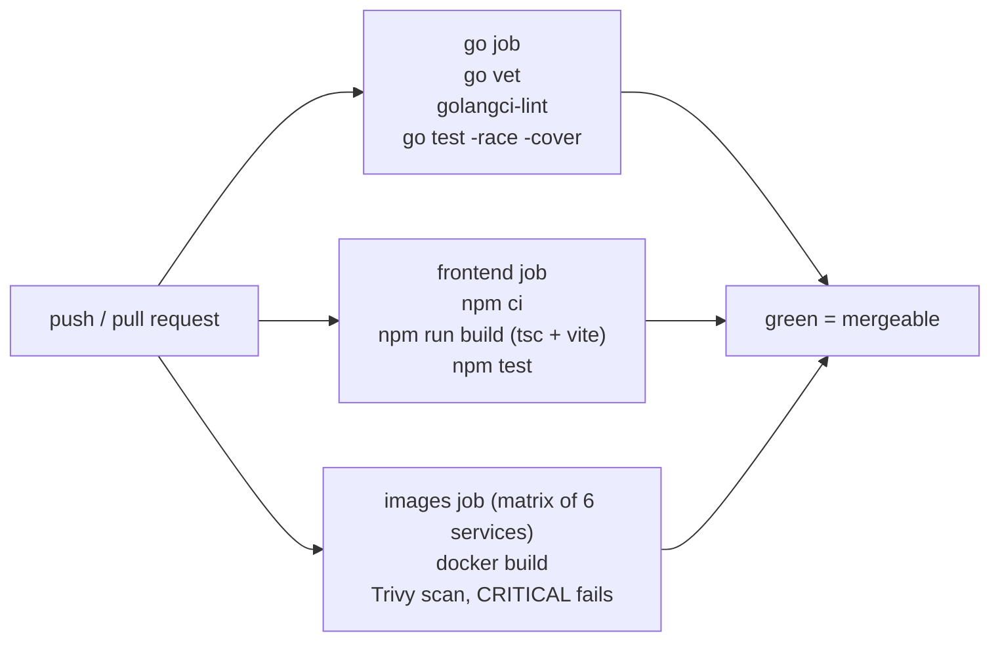

**Gaps to close** (recommended): run the **desktop tests** and the **end-to-end scripts** (against a stack started in the job), build the **documentation PDFs**, publish the **Windows installer** as a release asset, and add dependency update automation.

---

## 8. Git workflow

### 8.1 Where we are today

| Item | State |
|---|---|
| Remote | `github.com/irs269/EximPhone`, private |
| Branches | one: `main` (trunk), about 27 commits, direct pushes |
| Tags / releases | none yet |
| CI | on push and pull request (§ 7.2) |
| Commit messages | one descriptive sentence in English or French |

This is fine for a single developer building the first version. For a **team** and for a **bank** (traceability, change approval), we recommend the lightweight GitFlow below.

### 8.2 Recommended workflow (lightweight GitFlow)

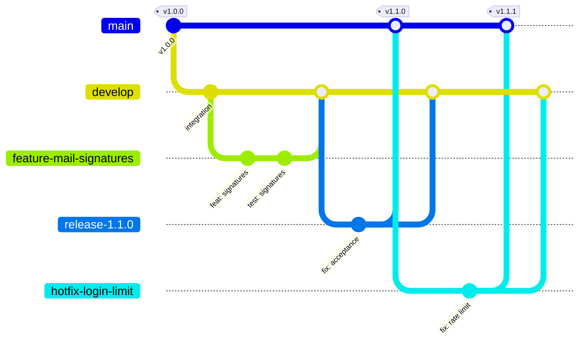

| Branch | Purpose | Created from | Merged into | Deployed to |
|---|---|---|---|---|
| `main` | what runs in **production**; every commit is a tagged release | — | — | production |
| `develop` | integration of finished features | `main` | `release/*` | **test** environment (VPS) |
| `feature/<topic>` | one feature or fix | `develop` | `develop` (pull request) | developer machine |
| `release/<x.y.z>` | freeze, acceptance, last fixes | `develop` | `main` and `develop` | test, then production |
| `hotfix/<topic>` | urgent production fix | `main` | `main` and `develop` | production |

**Rules**

1. **`main` and `develop` are protected**: no direct push, pull request required, CI green, **one review** (two for security-sensitive areas: authentication, crypto, remote control, audit).
2. **Short-lived branches**: a feature branch lives days, not weeks; rebase on `develop` before the pull request.
3. **Squash merge** for features (one clean commit per feature), **merge commit** for releases and hotfixes (keeps the release visible in history).
4. **Semantic versioning**: `vMAJOR.MINOR.PATCH`. Breaking changes (database, API contract) increment MAJOR; features MINOR; fixes PATCH. Tag on `main` only.
5. **Never rewrite published history** on `main` or `develop`.
6. **Secrets never enter Git** (`.env` is ignored; `.env.example` holds placeholders only). A leaked secret is revoked, not just deleted.
7. **Database changes** are a new numbered migration file; never edit one already applied.

**Commit messages** follow Conventional Commits, in English: `type(scope): summary`, with `feat`, `fix`, `docs`, `test`, `refactor`, `chore`, `ci`, `perf`, `security`. Examples: `feat(mail): external recipients through the SMTP relay`, `fix(media): release keys when the controller leaves`.

**Pull request checklist**

- [ ] The change is described (what, why) and linked to a ticket
- [ ] CI is green (Go, frontend, images)
- [ ] Tests added or updated (unit, and the relevant end-to-end script)
- [ ] Migration added if the schema changes (forward-only, tested on a copy)
- [ ] No secret, no personal data, no debug code
- [ ] Documentation updated (`docs/`, user manual if the screen changed)
- [ ] Reviewer approved

### 8.3 Releasing and deploying

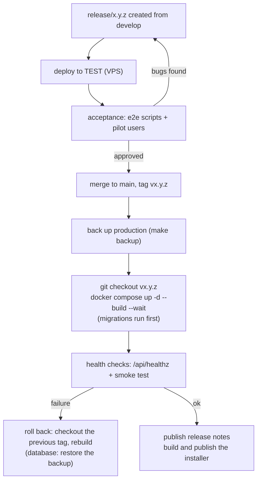

**Update procedure on a server** (one command at a time):

```bash
cd ~/EximPhone && git fetch --tags && git checkout v1.1.0
sh scripts/backup.sh
docker compose -f docker-compose.yml -f docker-compose.prod.yml up -d --build --wait
curl -sk https://localhost/api/healthz
```

Migrations are **forward-only** and run automatically through the one-shot `migrate` service before the API starts. A rollback of the **code** is a checkout of the previous tag; a rollback of the **database** is a restore of the pre-update backup, so **always back up first**.

---

## 9. Operations

| Topic | How |
|---|---|
| Logs | structured JSON (`slog`) on standard output of each container; `docker compose logs <service>` |
| Health | `/healthz` on every service; Docker health checks; `docker compose ps` |
| Metrics | `/metrics` endpoint on every Go service (to be scraped by the bank's monitoring) |
| Backups | `scripts/backup.sh` (encrypted dump + object store archive); `scripts/restore-test.sh` restores into a scratch database and compares counts; copy off the server daily |
| Secrets | `.env` generated by `scripts/gen-env.sh`; encryption keys (`MESSAGE_KEY`, `RECORDING_KEY`, `SIP_KEY`) kept **outside** the server and the backups |
| Updates | § 8.3; dependency updates reviewed and run through CI and Trivy |
| Capacity | one server (4 vCPU, 8 GB) for a few hundred users; media is the only CPU and bandwidth sensitive part |

---

## 10. Repository layout

```
EximPhone/
├── services/              Go module (one go.mod): api, media, sip, turn, provisioning, worker
│   ├── pkg/               shared code: attendance, crypto, directory, SDP, SIP auth, TURN, server base
│   ├── e2e/               Go end-to-end and load tests
│   └── Dockerfile         one multi-stage recipe for every service (build-arg SERVICE)
├── frontend/              React + TypeScript web app (built into the nginx image)
├── desktop/               Electron PC app: main process, remote control, Windows driver, tests
├── db/migrations/         numbered forward-only SQL migrations (000001 … 000012)
├── db/seed/               demo attendance data
├── nginx/                 templates (TLS, proxy, rate limits) and certificates
├── ldap-mock/             demonstration directory (20 users, dev and test only)
├── ops/garage/            object store image
├── scripts/               backup, restore test, deploy-test, load test, installer build, docs build, scan
├── tests/e2e/             end-to-end acceptance scripts (Node)
├── docs/                  architecture, ADRs, deployment, module guides, fr/ and en/ documentation
├── brand/                 logos and fonts
├── docker-compose*.yml    base + dev / test / prod overrides
├── Makefile               dev, up, down, logs, migrate, seed, test, certs, backup
└── .github/workflows/     continuous integration
```

---

## 11. Architecture decision records

| ADR | Decision | Why |
|---|---|---|
| 0001 | **Garage** (S3-compatible) instead of MinIO for object storage | the official MinIO images could no longer be downloaded; all code speaks the S3 API, so the store can be swapped |
| 0002 | Media **relayed by our server**, **G.711** (no transcoding) as soon as a phone is in the call | recording, SIP bridging and NAT traversal are only possible with a relay |
| 0003 | SIP **digest authentication** with passwords **sealed** (AES-256-GCM) | phones need their password in provisioning files; it must never be stored in clear |
| 0004 | **Encryption at rest** in the application, separate keys per purpose | a database or storage dump must not reveal messages, attachments or recordings |
| 0005 | Real-time events over **WebSocket and Redis pub/sub** | updates in under a second and more than one api instance |
| 0006 | **Attendance is the login**, with a network check | reliable clock-in data without a separate badge system |

The full texts are in `docs/adr/`.

---

## 12. Known technical limits

| Limit | Impact | Planned answer |
|---|---|---|
| Object store runs on **one node** (replication factor 1) | losing the volume loses attachments and recordings | replicated layout or daily volume backups (§ 9) |
| Encryption keys are in the environment; **no key rotation job** yet | rotating a key means re-encrypting by hand | key vault / KMS behind the existing `Box` type, plus a re-encryption job |
| **No end-to-end encryption** (the server can read messages by design) | needed for compliance and recording | documented choice (ADR 0004) |
| SIP digest still accepts **MD5** for old phones | weaker for legacy devices | disable once the phone fleet supports SHA-256; use SIP over TLS |
| **Redis** is a dependency of real-time features | if it is down, chat and calls stop; attendance and history keep working | Redis high availability in production |
| Messages cannot be searched in SQL (they are encrypted) | search decrypts the latest messages in the api | acceptable at this size; revisit if volumes grow |
| Remote control is **Windows only** | no macOS / Linux owners | out of scope for the first release |

---

## 13. Glossary

| Term | Meaning |
|---|---|
| **SFU** | Selective Forwarding Unit: a server that receives each participant's stream once and forwards it to the others |
| **WebRTC** | browser standard for real-time audio and video |
| **SIP / RTP / SRTP** | telephony signalling / media transport / encrypted media transport |
| **STUN / TURN** | helpers that let media cross firewalls and NAT |
| **DTLS-SRTP** | the encryption WebRTC uses for media |
| **LDAP / LDAPS** | directory protocol (Active Directory) / its encrypted form |
| **JWT** | signed token carrying the user identity and expiry |
| **RBAC** | role-based access control |
| **ADR** | architecture decision record |
| **Forward-only migration** | a database change that is never edited or undone afterwards; corrections are new migrations |
| **Distroless** | minimal container image with no shell or package manager, reducing the attack surface |
