# Exim Connect — User Manual

*Step-by-step guide for Exim Bank employees. The screenshots come from a demonstration environment: names and data are fictitious.*

---

## 1. Getting started

### 1.1 Opening Exim Connect

Exim Connect can be used in two ways, with the same account:

- **in a web browser** (Chrome, Edge…), at the address given by IT;
- **with the PC application** (Windows), which opens like any other program. It is **required for remote control** (see § 5.5). To install it: your profile menu (bottom left) → **Download and install**, or the **Help** page.

### 1.1 bis Being signed in automatically in the PC application

You **do not need to type your password again** in the PC application if you are already signed in on the site:

- **From the site**: in the profile menu or on the **Help** page, click **Open in the PC application**. Windows may ask permission to open Exim Connect: accept. The application opens with your session.
- **From the application**: on its sign-in screen, click **Sign in with my browser**. The browser opens; if you are already signed in there, you come back to the application signed in.
- **Right after installing**: the very first time the application starts, the browser opens once to do this automatically.

This does **not create a new clock-in**: your arrival stays the one of your first sign-in of the day. If you clocked out in the meantime, you must type your password again.

### 1.2 Signing in

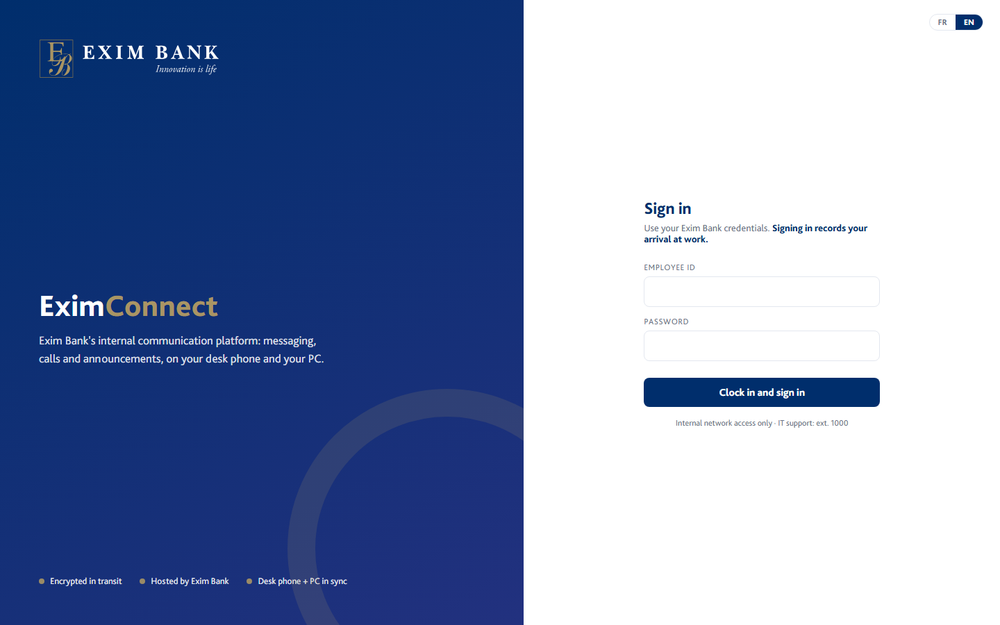

Enter your **Exim Bank credentials** (the same as for your computer). The **FR / EN** buttons at the top change the language.

> **Important: signing in is your arrival clock-in.** It is only accepted from the **bank's internal network**. From outside, a message tells you that clocking in is not possible.

### 1.3 Your arrival is recorded

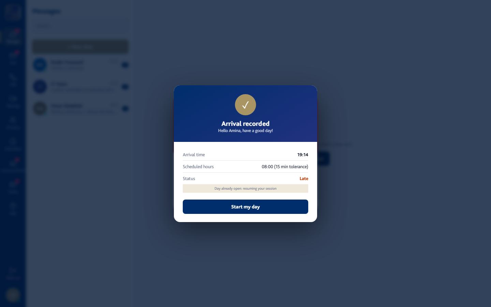

A window confirms your **arrival time**, your **scheduled hours** (here 08:00, with a 15-minute tolerance) and your **status** ("Present" or "Late"). Click **Start my day**.

### 1.4 Urgent announcements

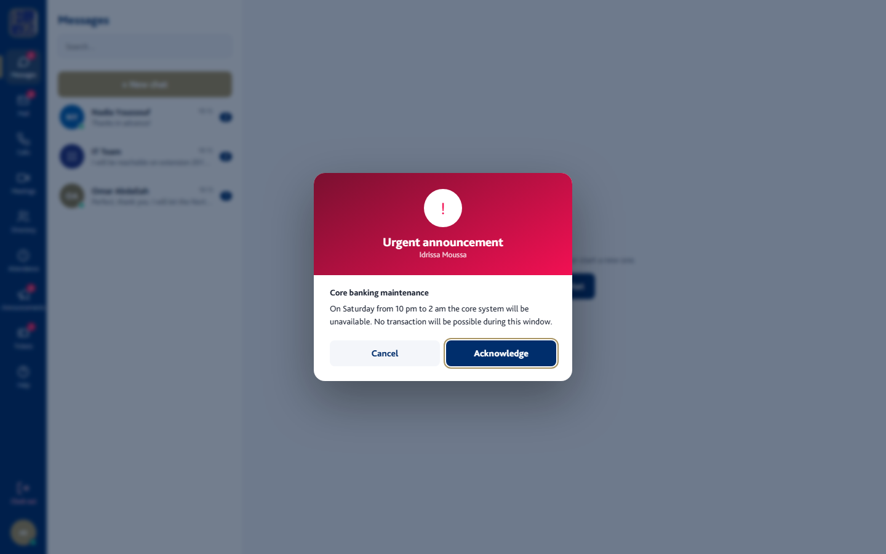

When management or communication publishes an **urgent announcement**, it appears in the middle of the screen until you click **Acknowledge**. The sender can then see who has read it.

### 1.5 Finding your way around

The **blue bar on the left** gives access to every module:

| Button | What it is for |
|---|---|
| **Messages** | instant chat, one-to-one or in groups |
| **Mail** | internal and external e-mail |
| **Calls** | telephone: call a colleague or a number |
| **Meetings** | video meetings, screen sharing, remote control |
| **Directory** | find a colleague, see their presence |
| **Attendance** | your clock-in and its history |
| **Announcements** | memos and circulars |
| **Tickets** | requests sent to services (IT, HR…) |
| **Team** | HR or manager dashboard (depending on your role) |
| **Audit** | traceability log (auditors only) |
| **Help** | quick answers, support contacts, PC application |
| **Clock out** | clock out and sign out |

The **red badges** show what needs your attention (unread messages, mail, announcements, tickets).

### 1.6 Your status, the language and the PC application

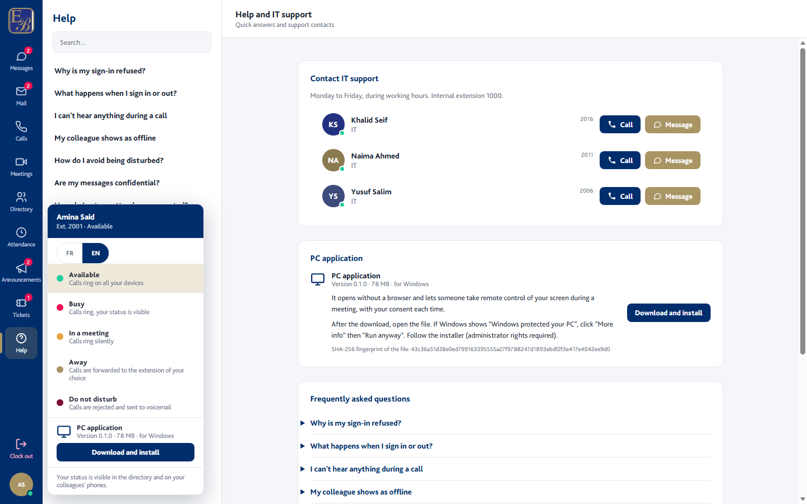

Click your **round avatar at the bottom left**:

- **FR / EN**: switches the interface language;
- **Available, Busy, In a meeting, Away, Do not disturb**: your status, visible to everyone in the directory. It also decides how your calls ring;
- **Download and install**: installs the PC application.

---

## 2. Messages

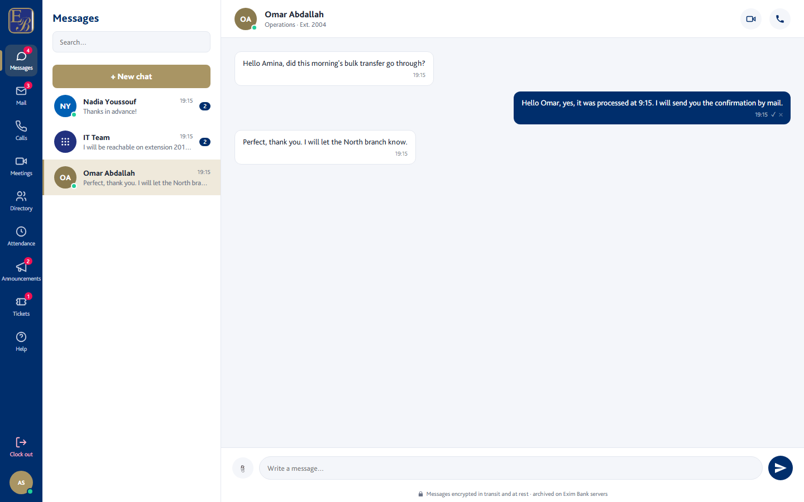

- **Conversation list** on the left, the conversation on the right. A **green dot** means the person is online.
- Type in the bottom box and send with **Enter** or the round button. The paperclip attaches a **file**.
- The two icons at the top right start a **video call** or an **audio call** with the person.
- The **Search** box (top left) finds a message across all your conversations.
- Messages are **encrypted** and kept on the bank's servers.

### Group chat

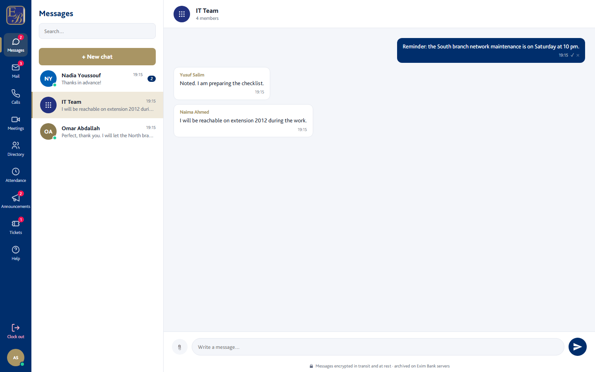

### Starting a chat

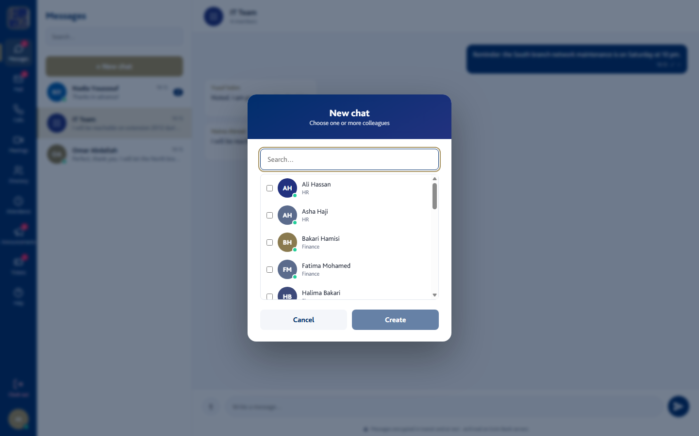

Click **+ New chat**, then choose one colleague (one-to-one chat) or several colleagues and a **group name**.

---

## 3. Mail

Mail works between colleagues, and can also **write to outside addresses** if the bank has enabled that option (see the roadmap).

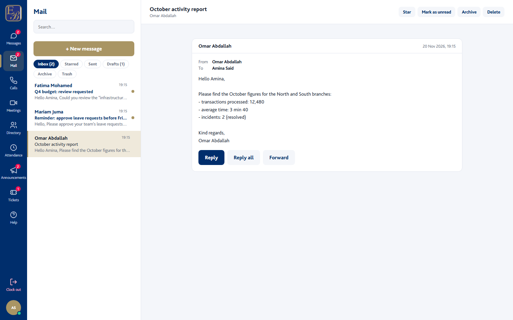

- Folders: **Inbox, Starred, Sent, Drafts, Archive, Trash**.
- Messages are grouped into **conversations**: a reply stays in the same thread.
- At the top right of a message: **Star**, **Mark as unread**, **Archive**, **Delete**; at the bottom: **Reply**, **Reply all**, **Forward**.
- The **Search** box looks in the subject, the text, the sender and the recipients.

### Writing a message

Click **+ New message**.

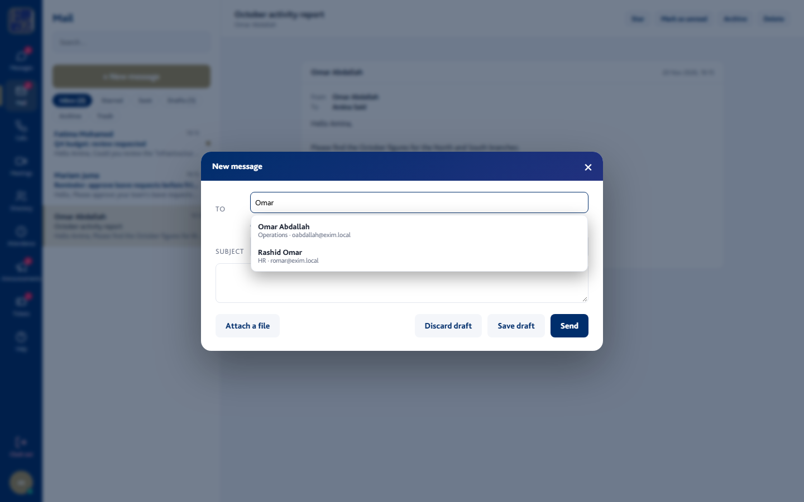

1. In **To**, type a few letters of a name: the list suggests colleagues. Click the right one.
2. For an **outside address**, type the full address and press **Enter**.
3. **Cc / Bcc**: visible copy or hidden copy. Bcc recipients are never visible to the others.
4. Fill in the **subject** and the message.
5. **Attach a file**: up to 10 files of 20 MB (25 MB in total). Executable programs (.exe, .bat, .js…) are refused for security reasons.

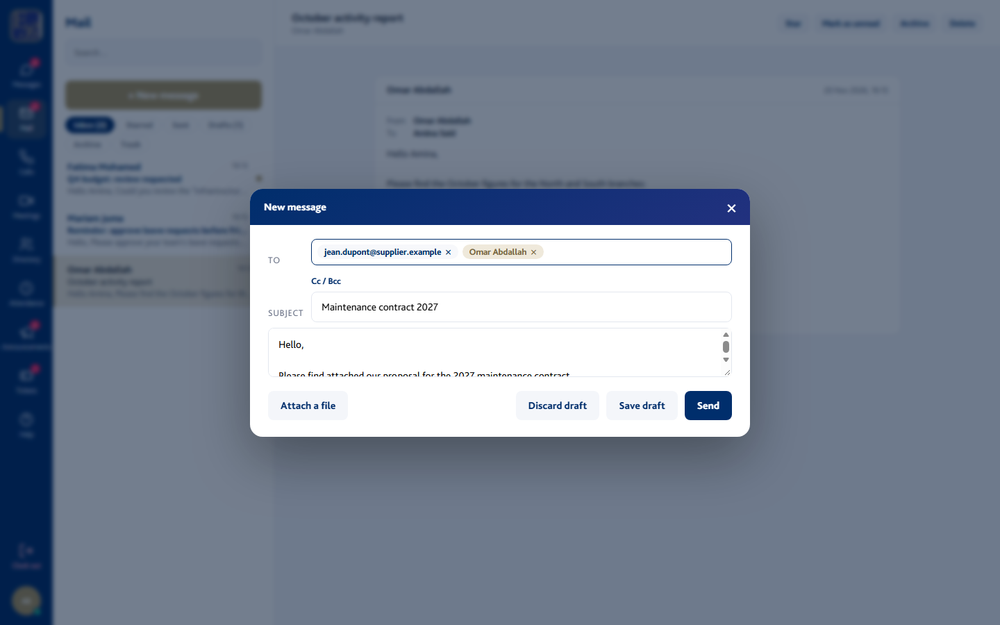

The message is **saved automatically as a draft** a few seconds after your last keystroke. **Send** sends it, **Discard draft** abandons it, **Save draft** saves it right away.

> An outside address is shown with the **External** label. If delivery fails, a "Delivery failure" message arrives in your inbox.

---

## 4. Calls

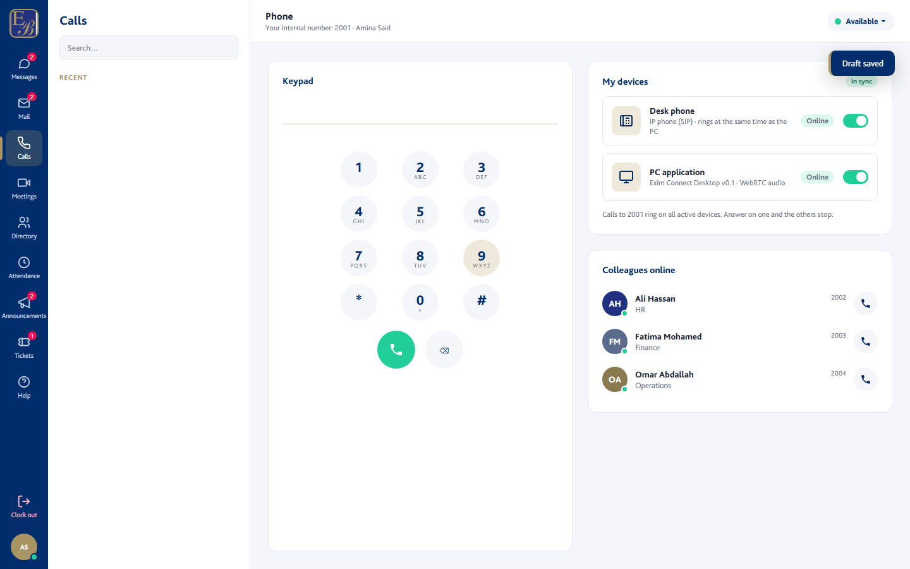

- Your **internal number** is shown at the top (here 2001).
- Dial a number on the **keypad**, or click the phone icon next to a colleague (directory, messages).
- **Your devices**: a call to your number rings on your **PC and on your desk IP phone at the same time**. You answer wherever you like.
- Recent calls are listed on the left.
- Your **status** (Busy, In a meeting, Do not disturb) decides whether the phone rings.

---

## 5. Meetings

### 5.1 The Meetings page

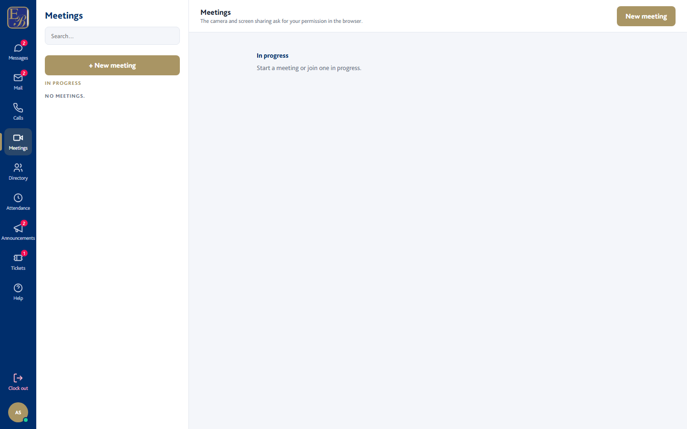

The **ongoing** meetings you are invited to appear on the left: one click to join. The first time, the camera and microphone ask for your **permission** in the browser.

### 5.2 Starting a meeting

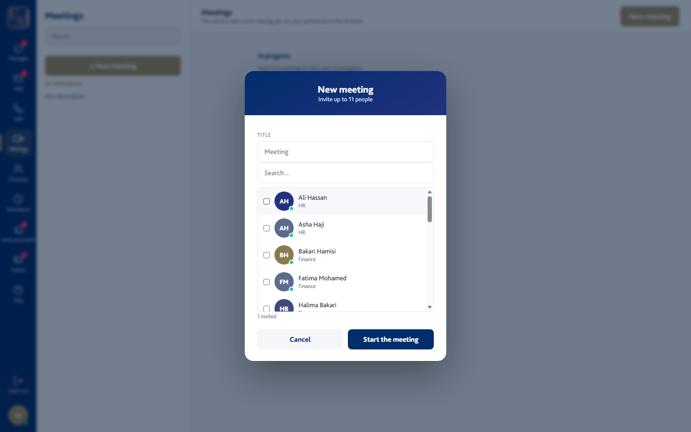

1. **+ New meeting**.
2. Give it a **title** (optional).
3. Tick the **guests** (up to 11 people, so 12 with you). Use the search box to find them.
4. **Start the meeting**. Guests get an alert and join with one click. You can **invite more people** later with the **Invite** button.

### 5.3 In the room

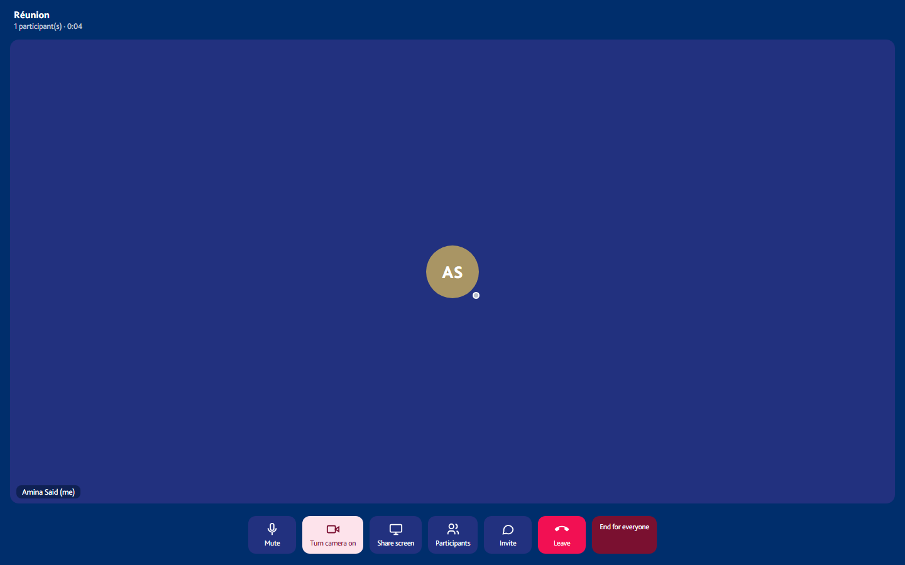

The buttons at the bottom:

| Button | Action |
|---|---|
| **Mute** | mutes / unmutes your microphone |
| **Turn camera off / on** | turns your camera off / on |
| **Share screen** | shows your screen, or a window, to the participants |
| **Participants** | list of people present |
| **Invite** | adds colleagues |
| **Leave** | you leave, the meeting goes on |
| **End for everyone** | (organiser) closes the meeting for everybody |

*When the camera is off, your initials are shown instead.* A **one-to-one video call** can also be started from a chat (camera icon).

### 5.4 Sharing your screen

Click **Share screen**. In the **PC application**, a window offers:

- **Screens**: your whole screen (this one can be remotely controlled);
- **Windows**: a single window (it cannot be controlled).

Choose, then click **Share**. A yellow banner confirms whether **remote control** is possible. Stop sharing at any time with the same button.

### 5.5 Taking control of a colleague's screen

*Available to people who use the **PC application** (the one who shares) and to the colleagues who watch.*

**To request control:**

1. Your colleague shares their **whole screen** from the PC application.
2. Move the mouse over their shared screen: the **Request control** button appears. Click it.
3. Wait: a window opens **on your colleague's computer**, and they must click **Allow**. If they refuse or do not answer within 30 seconds, the request stops.
4. Once accepted, a golden frame surrounds the screen. You can **move the mouse, click, scroll and type**. A bar at the top of the screen offers **Full screen** and **Stop control**.

**To accept (the person being controlled):**

1. A window asks whether you allow *"X is asking to take control of your screen"*. Only click **Allow** if **you know the person and were expecting the request**. The default button is **Refuse**.
2. During the control, a **red banner** stays at the top of your screen. You can **stop at any time** with its button or with the shortcut **Ctrl + Alt + Shift + X**.
3. Control also stops by itself after **one hour**, or as soon as you stop sharing.

**Good to know:**
- The **Windows key** is never transmitted, and the lock screen, User Account Control (UAC) windows and **Ctrl+Alt+Delete** cannot be controlled.
- Typing follows **the keyboard layout** of the controlled computer: AZERTY or QWERTY, it works.
- The start and end of every control session are **recorded** in the audit log.

---

## 6. Directory

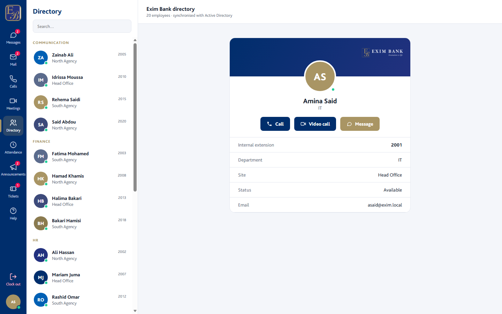

All colleagues, grouped by **department**, with their **internal extension**, their **site** and their **presence status**. Click a name to **message, call or start a video call**.

---

## 7. Attendance

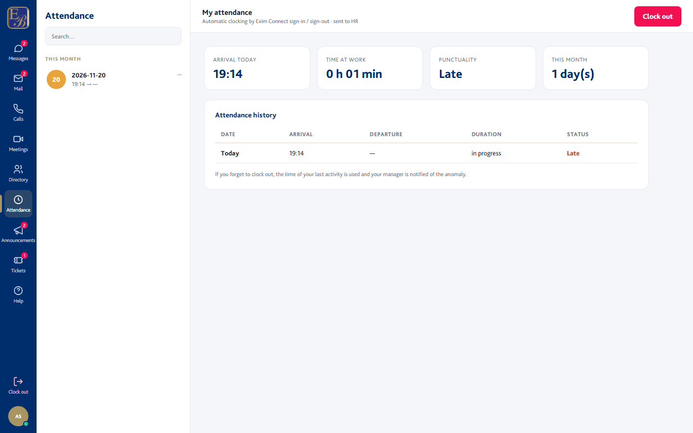

This page shows your **arrival time**, your **time at work** today, your **punctuality** and the month's **history**. There is nothing to enter: clocking is done **when you sign in and sign out**.

### Clocking out

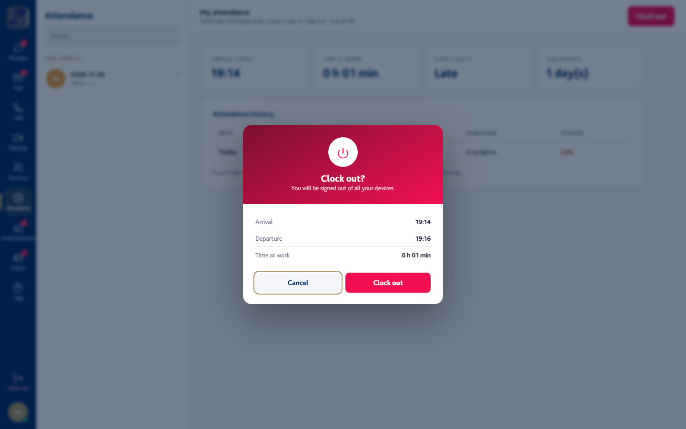

Click **Clock out** (at the top right of the page, or in the left bar). A window summarises your arrival, departure and duration. **You are signed out of all your devices.**

- If you leave **before the end of the day** (17:00 by default), a **reason** is requested: your manager will approve it.
- If you forget to clock out, the system **closes the day** at midnight with the time of your last activity, and the anomaly is reported to your manager.

---

## 8. Announcements

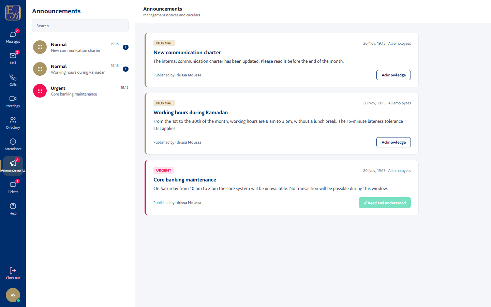

The **memos and circulars** from management, communication and HR. A **red badge** shows announcements you have not read yet. **Urgent** announcements open in a window (see § 1.4).

---

## 9. Tickets: requests to services

A **ticket** is a request sent to a service (IT, HR, finance…). The **head of the service** approves or rejects it, then **assigns it to a member of their team**, who handles it.

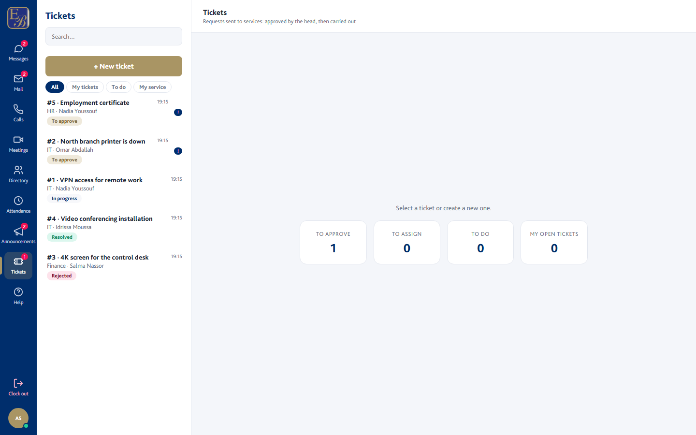

The list filters: **All**, **My tickets**, **To do** (what you must handle or approve), **My service**. The coloured labels show the status: *To approve, Approved · to assign, Assigned, In progress, Resolved, Rejected, Cancelled*.

### Making a request

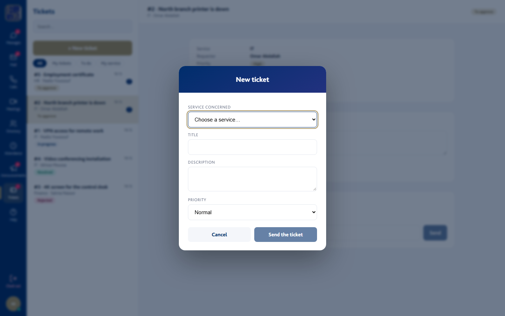

1. **+ New ticket**.
2. Choose the **service** concerned.
3. Give a **title**, a clear **description** and a **priority**.
4. Submit. The head of the service is notified immediately. You follow progress in **My tickets**, with the complete history.

### If you are the head of a service

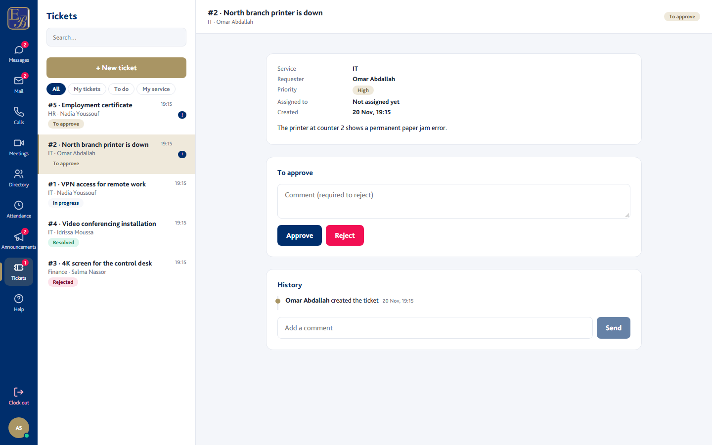

Open a ticket that is **To approve**:

- **Approve** (optional comment): the ticket becomes *Approved · to assign*; then **assign it** to a member of your team.
- **Reject**: a **comment is mandatory** (the requester must understand why).

### If a ticket is assigned to you

Open it: **Take it on** (status *In progress*), then **Mark as resolved** with a comment when it is done. The requester can **cancel** their ticket as long as it has not been handled, and a head of service can **reassign** a ticket that is in progress.

---

## 10. Team: HR and manager dashboard

*Visible to the HR and manager roles only.*

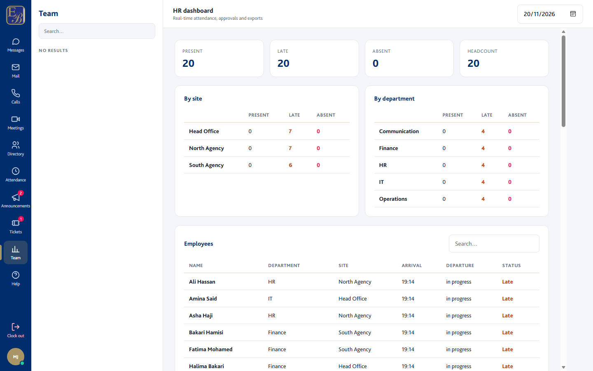

- At the top: **present, late, absent, headcount** for the day (choose the date at the top right).
- **By site** and **by department**: the breakdown.
- **Employees**: one row per person, with arrival, departure and status.
- A **manager** sees their team. **HR** sees everyone, **approves early departures**, **corrects a clock-in** (with a written reason of at least 5 characters; the previous value is kept) and **exports the month's file** (Excel or CSV).

> A day without a clock-in counts as an absence: on Saturdays, Sundays and public holidays everybody therefore appears absent (no holiday calendar is managed yet).

---

## 11. Audit

*Visible to the auditor role only.*

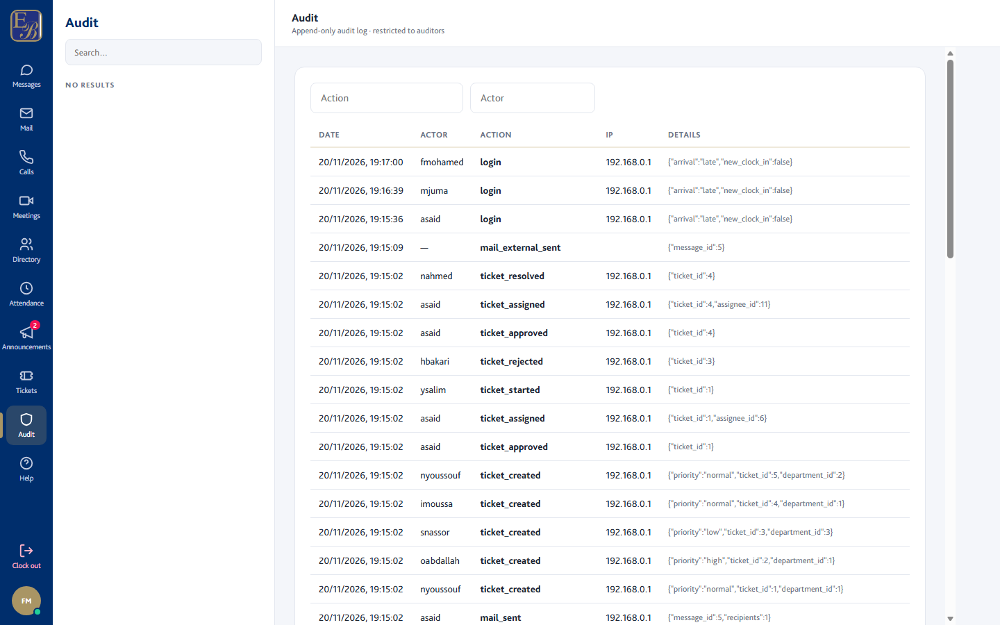

The **append-only log**: sign-ins, sign-outs, role changes, attendance corrections, mail sent (without its content), start and end of remote control… It **can be neither modified nor erased**. Every consultation is itself recorded.

---

## 12. Help

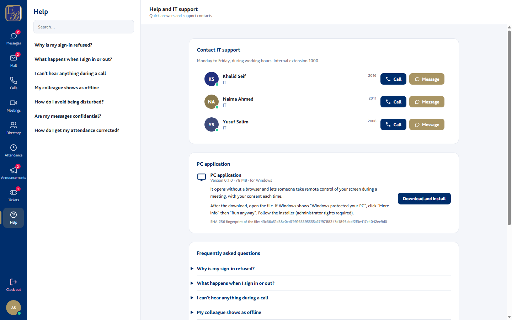

- **Contact IT support**: call or message one of the support staff in one click.
- **PC application**: current version and a **Download and install** button. After downloading, open the file. If Windows shows "Windows protected your PC", click **More info**, then **Run anyway**, and follow the installer (administrator rights required). The file's fingerprint is shown so IT can verify it.
- **Frequently asked questions**: answers to common problems.

### Quick troubleshooting

| Problem | What to do |
|---|---|
| "Clock-in is only possible from the internal network" | You are outside the bank's network. Sign in from the office (or the VPN if it is open). |
| I cannot hear anything during a call | Check the microphone and speakers selected in the browser or in Windows, then reload the page. |
| The **Request control** button does not appear | Your colleague must use the **PC application**, share their **whole screen** (not a window), and you must be in the meeting. |
| My colleague appears offline | They are not signed in, or their status is "Do not disturb". |
| The page does not update | Refresh with **Ctrl + F5**. |

---

## 13. Security good practice

- **Never share your password.** Nobody, including IT, will ask you for it.
- **Only allow remote control if you are expecting the request** and know the person. If in doubt, **refuse**, then call the person to check.
- During a screen share, **close what you do not want to show** (e-mail, confidential documents).
- **Lock** your computer (Windows + L) whenever you step away.
- Report anything strange to IT (internal extension 1000).
