# Exim Connect — Fonctionnalités

*Document de présentation pour la direction, la DSI et les équipes métier.*

---

## 1. En bref

**Exim Connect** est la plateforme de **communication interne et de gestion de la présence** d'Exim Bank. Elle remplace plusieurs outils séparés par une seule application, hébergée **sur les serveurs de la banque** (aucune donnée ne quitte la banque) et connectée à son **annuaire d'entreprise**.

| | |
|---|---|
| **Qui l'utilise** | tous les collaborateurs, avec les mêmes identifiants que leur poste de travail |
| **Où** | dans un navigateur, dans l'**application PC** Windows, et sur les **téléphones IP de bureau** |
| **Langues** | français et anglais (changement en un clic) |
| **Où sont les données** | chez Exim Bank : base de données, fichiers et enregistrements sont chiffrés |

Neuf besoins sont couverts dans la même interface : **pointage, messagerie instantanée, courrier, téléphonie, réunions vidéo, annuaire, annonces, tickets** et **tableaux de bord RH**, avec un **journal d'audit** pour la conformité.

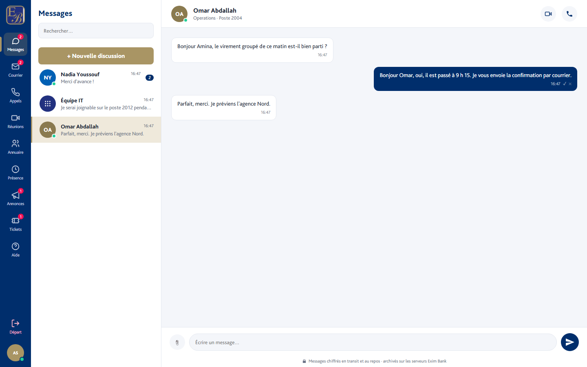

---

## 2. Les modules

| Module | Ce qu'il apporte |
|---|---|
| **Présence** | pointage automatique à la connexion/déconnexion, règles de retard et de départ anticipé |
| **Messages** | discussions individuelles et de groupe, pièces jointes, recherche, indicateurs d'envoi |
| **Courrier** | courriel interne complet **et envoi/réception vers l'extérieur** via le serveur de messagerie de la banque |
| **Appels** | téléphonie sur PC et sur **téléphone IP de bureau**, numéro interne unique, enregistrement chiffré |
| **Réunions** | vidéo jusqu'à 12 personnes, partage d'écran, **prise de contrôle à distance** |
| **Annuaire** | collègues par service, poste, site, statut en temps réel |
| **Annonces** | notes de service, annonces urgentes avec accusé de réception |
| **Tickets** | demandes aux services, validation par le responsable, affectation, suivi |
| **Équipe / RH** | tableaux de bord, validations, corrections, export mensuel des présences |
| **Audit** | journal de traçabilité inaltérable |
| **Application PC** | installation en un clic depuis le site, prise de contrôle sécurisée |

---

## 3. Détail des fonctionnalités

### 3.1 Connexion et pointage de présence

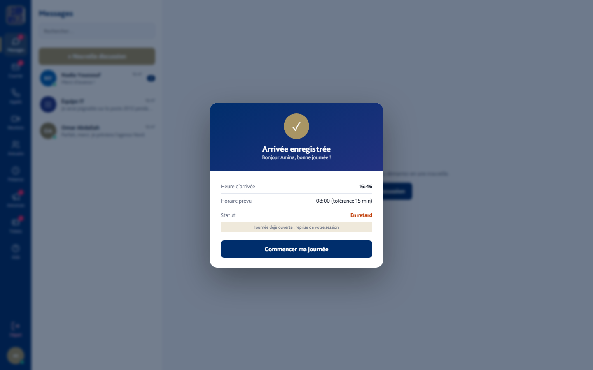

- **Authentification par l'annuaire** d'entreprise (Active Directory / LDAP) : pas de nouveau mot de passe.
- **La connexion vaut pointage d'arrivée**, et la déconnexion pointage de départ, après une fenêtre de confirmation.
- **Contrôle du réseau** : le pointage n'est accepté que depuis les **plages d'adresses de l'agence** de l'employé (configurables par site ; désactivé pendant la phase de test).
- **Retard** : arrivée après l'heure de début + tolérance (par défaut 8 h 00 + 15 min).
- **Départ anticipé** : avant l'heure de fin (par défaut 17 h 00), un **motif obligatoire** est demandé et validé par le responsable.
- **Oubli de départ** : la journée est clôturée automatiquement à minuit, avec l'heure de la dernière activité, et signalée au responsable.
- **Un seul pointage par jour**, quel que soit le nombre d'appareils.
- Fuseau horaire et horaires **par site**.

### 3.2 Messagerie instantanée

- Discussions **individuelles et de groupe**, en **temps réel**.
- **Pièces jointes**, recherche dans l'historique, suppression logique des messages.
- Présence visible (en ligne, occupé, en réunion, absent, ne pas déranger).
- Chiffrement des messages **en transit et au repos**.

### 3.3 Courrier

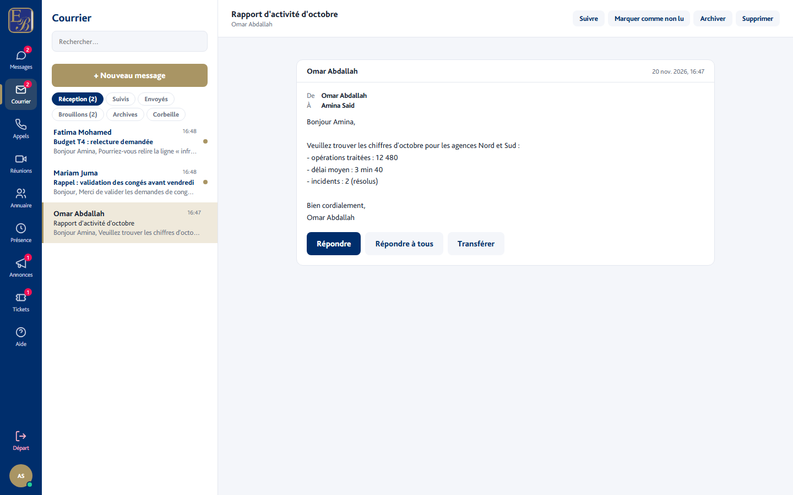

- **To, Cc, Cci** avec complétion sur l'annuaire ; **brouillons** enregistrés automatiquement ; **conversations** (fils de discussion).
- **Répondre, répondre à tous, transférer** (avec pièces jointes).
- Dossiers **Réception, Suivis, Envoyés, Brouillons, Archives, Corbeille** ; recherche ; notifications en temps réel.
- **Pièces jointes** : 10 fichiers de 20 Mo au maximum (25 Mo par message), exécutables et scripts refusés.
- **Courrier externe** : écrire à une adresse extérieure et **recevoir** les réponses, par le serveur de messagerie existant de la banque (option, voir la feuille de route).
- Objet et texte **chiffrés au repos** ; messages en texte brut (aucun risque de script ou de pixel espion).

### 3.4 Téléphonie

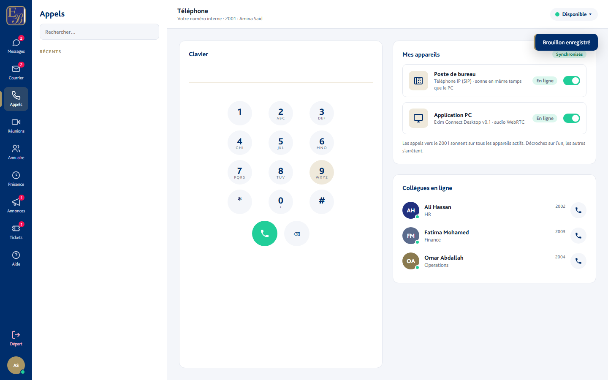

- Appels **depuis le PC** (navigateur ou application) et depuis un **téléphone IP de bureau**, qui **sonnent en même temps**.
- **Numéro interne unique** par personne, quel que soit l'appareil.
- Appels **entre collègues** de la banque (le raccordement à un opérateur téléphonique n'est pas inclus : voir la feuille de route).
- **Enregistrement chiffré** des appels, avec une durée de conservation configurable (365 jours par défaut) et des accès journalisés.
- Les téléphones IP sont **configurés automatiquement** (provisioning).

### 3.5 Réunions vidéo, partage d'écran et prise de contrôle

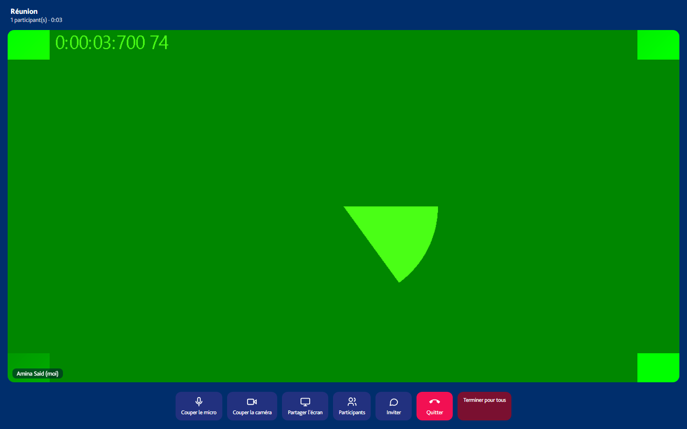

- **Réunions jusqu'à 12 participants** et **appels vidéo à deux** depuis une discussion.
- **Partage d'écran** (écran entier ou fenêtre).
- **Prise de contrôle à distance** : un participant peut piloter l'écran d'un collègue. Voir l'encadré ci-dessous.
- Vidéo gérée par le **serveur de la banque** (aucun service extérieur).

> **Prise de contrôle : sécurisée par conception**
> - seul l'**écran entier**, partagé depuis l'**application PC**, peut être contrôlé ;
> - une **fenêtre native** demande l'accord de la personne, qui ne peut être validée ni imitée par une page web ;
> - un **bandeau rouge permanent** et un **raccourci d'arrêt** (Ctrl+Alt+Maj+X) restent à portée de la personne contrôlée ;
> - la session s'arrête **seule au bout d'une heure** ou dès que le partage s'arrête ;
> - la touche Windows, l'écran de verrouillage et Ctrl+Alt+Suppr ne sont **jamais** transmis ;
> - chaque début et fin de session est **tracé** dans le journal d'audit.

### 3.6 Annuaire et statuts

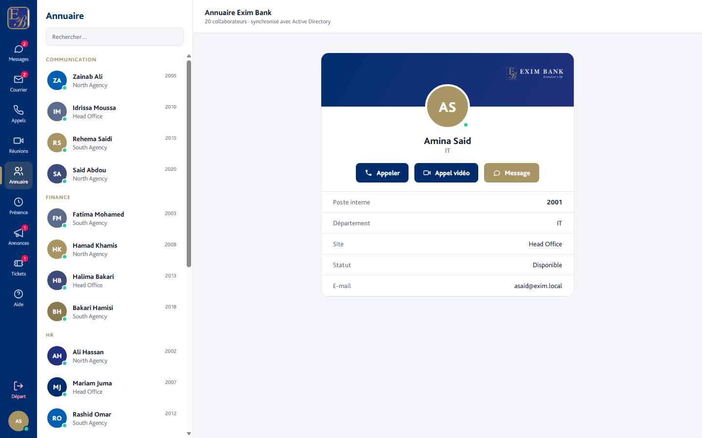

Collaborateurs par service, avec **poste**, **site** et **statut** (disponible, occupé, en réunion, absent, ne pas déranger). Depuis une fiche : **appeler, écrire, lancer une visio**. Le statut commande la sonnerie des appels.

### 3.7 Annonces

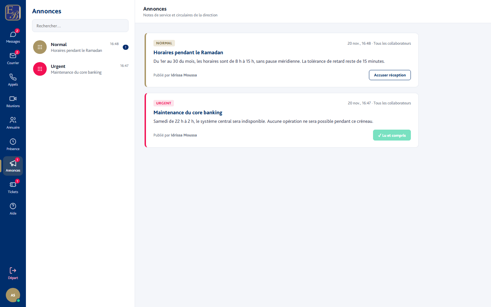

- Publication par la **communication** ou la **direction**, vers tous, un service ou un site.
- **Annonces urgentes** : fenêtre affichée **jusqu'à l'accusé de réception**, même après une reconnexion.
- **Suivi de lecture** : qui a lu, qui n'a pas lu.

### 3.8 Tickets : demandes aux services

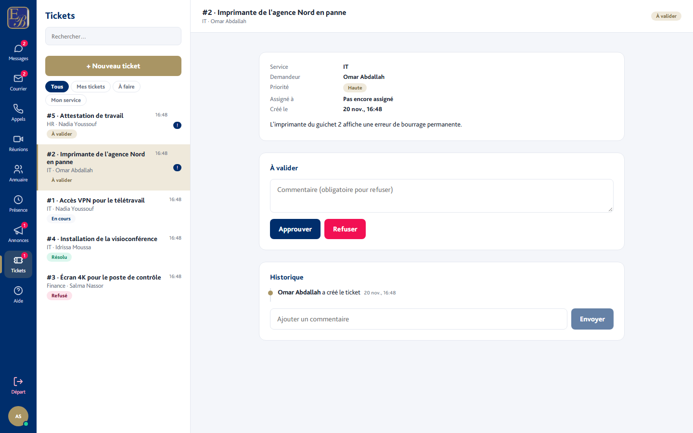

Circuit complet : **demande → validation par le responsable du service → affectation à un membre → traitement → résolution**.

- Statuts : à valider, approuvé, refusé, assigné, en cours, résolu, annulé.
- **Historique complet** (qui a fait quoi, quand, avec quel commentaire), notifications en temps réel.
- Un **refus** exige toujours un commentaire.
- Filtres : mes tickets, à faire, mon service.

### 3.9 Équipe : tableaux de bord RH et managers

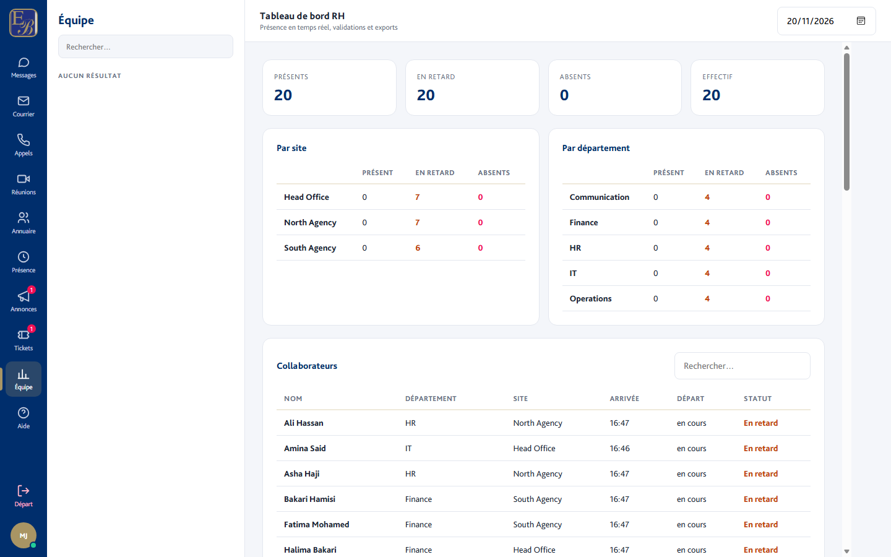

- **Présents, retards, absents** par site et par service, en temps réel.
- Le **manager** voit son équipe ; les **RH** voient toute la banque.
- **Validation des départs anticipés**, **corrections de pointage justifiées** (l'ancienne valeur est conservée).
- **Export mensuel des présences** : Excel (détail et synthèse par employé) et CSV ; protégé contre l'injection de formules.

### 3.10 Audit et traçabilité

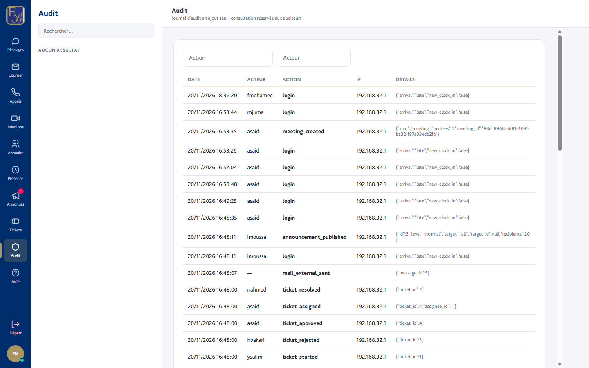

Journal **en ajout seul**, impossible à modifier ou effacer (protégé par la base de données). Il enregistre : connexions et échecs, refus de réseau, déconnexions, changements de rôles, corrections de pointage, exports RH, publications d'annonces, envois de courrier (sans contenu), début et fin de prise de contrôle. **Chaque consultation du journal est elle-même tracée.**

### 3.11 Application PC et aide

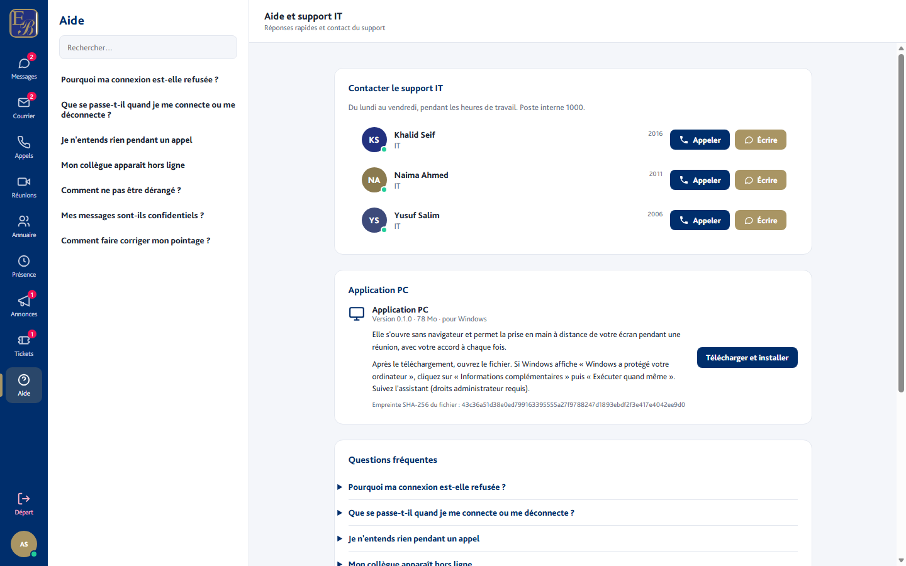

- **Installation en un clic** depuis le site (menu du profil ou page Aide), avec **empreinte SHA-256** du fichier pour vérification.
- Page **Aide** : contact du support IT, questions fréquentes, téléchargement.

---

## 4. Rôles et droits

Tout utilisateur est **employé**. Les autres rôles sont attribués par l'**administrateur IT** et agissent immédiatement.

| Rôle | Peut en plus |
|---|---|
| **Employé** | pointer, écrire, appeler, réunions, courrier, tickets, lire et accuser les annonces |
| **Manager** | voir son équipe, valider les départs anticipés de son équipe |
| **RH** | voir tout le monde, valider les départs anticipés, corriger des pointages, exporter les présences du mois, suivre la lecture des annonces |
| **Communication / Direction** | publier des annonces et suivre qui les a lues |
| **Responsable de service** | approuver ou refuser les tickets de son service, les assigner |
| **Administrateur IT** | gérer rôles, managers, sites (plages IP, horaires, tolérance), téléphones |
| **Auditeur** | consulter le journal d'audit |

Garde-fous : un administrateur ne peut pas retirer son propre rôle ; un manager ne peut pas valider son propre départ anticipé ; le demandeur d'un ticket ne peut pas l'approuver.

---

## 5. Sécurité et conformité

| Domaine | Mesure |
|---|---|
| **Hébergement** | sur les serveurs de la banque, aucune donnée chez un tiers |
| **Authentification** | annuaire d'entreprise, jetons d'accès à courte durée, droits relus à chaque requête |
| **Réseau** | accès filtré par plages d'adresses par agence ; limitation du débit des connexions |
| **Chiffrement en transit** | TLS partout (HTTPS, WebSocket sécurisé, média chiffré) |
| **Chiffrement au repos** | messages, courriers, pièces jointes et enregistrements en AES-256-GCM, clés séparées de la base |
| **Traçabilité** | journal d'audit en ajout seul, consultations tracées |
| **Pièces jointes** | exécutables et scripts refusés, téléchargements forcés |
| **Prise de contrôle** | consentement natif, bandeau, arrêt immédiat, limite de durée, journalisation |
| **Sauvegardes** | script de sauvegarde chiffrée (base et fichiers), test de restauration fourni ; la planification quotidienne reste à mettre en place en production |
| **Qualité** | plus de 230 tests automatiques de bout en bout, tests unitaires des services et de l'application PC |

---

## 6. Architecture en bref

L'application s'exécute sous forme de **conteneurs** sur un serveur Linux :

| Composant | Rôle |
|---|---|
| **nginx** | point d'entrée unique, HTTPS, site web, limites de débit |
| **api** | logique métier : pointage, messages, courrier, tickets, annonces, RH |
| **media** | audio/vidéo des appels et des réunions, partage d'écran |
| **sip** | téléphonie, téléphones IP |
| **turn** | traversée de réseau pour les appels |
| **provisioning** | configuration automatique des téléphones IP |
| **worker** | tâches planifiées (clôture des journées oubliées, synchronisation de l'annuaire, durée de conservation des enregistrements) |
| **PostgreSQL / Redis** | données et temps réel |
| **Stockage objet** | pièces jointes et enregistrements chiffrés |
| **Annuaire** | Active Directory / LDAP de la banque |

L'**application PC** est une application Windows (Electron) qui affiche le même site, avec en plus la prise de contrôle.

---

## 7. Déploiement

- **Environnement de test** : déployé sur un serveur dédié, avec un certificat de test et un annuaire fictif, pour valider avec quelques utilisateurs.
- **Production** : certificat de l'autorité interne de la banque, annuaire réel (LDAPS), plages d'adresses réelles, serveur de messagerie existant, sauvegardes planifiées. La liste des étapes figure dans la **feuille de route**.
