# Exim Connect — Guide technique

*Technologies, architecture, schémas, démarche qualité et workflow Git. Pour les développeurs, l'exploitation informatique et la revue de sécurité.*

---

## 1. Principes de conception

| Principe | Ce que cela signifie concrètement |
|---|---|
| **Sur site, rien à l'extérieur** | Tout tourne sur les serveurs de la banque. Les services métier (SIP, média, messagerie, pointage, courrier, tickets) sont notre propre code ; les logiciels tiers se limitent à des bibliothèques et à l'infrastructure standard. |
| **Un seul code, une seule recette d'image** | Un seul module Go construit tous les services back-end à partir d'un Dockerfile multi-étapes partagé ; les images sont minimales (*distroless*, sans droits root). |
| **Configuration par l'environnement** | Aucun secret dans le code. Tout vient du fichier `.env` (douze facteurs) ; des fichiers compose superposés choisissent dev, test ou production. |
| **Sécurité par défaut** | TLS partout, chiffrement des données au repos par l'application, audit en ajout seul, rôles relus à chaque requête, consentement explicite pour la prise de contrôle. |
| **Technologies éprouvées et auditables** | PostgreSQL, Redis, nginx, standards WebRTC/SIP. Aucune dépendance exotique ; les quelques bibliothèques sont connues et figées en version. |
| **Tout est testé de bout en bout** | Chaque fonctionnalité est livrée avec un script de recette exécuté sur la vraie pile (§ 7). |

---

## 2. Technologies utilisées

### 2.1 Vue d'ensemble par couche

| Couche | Technologie | Version | Rôle |
|---|---|---|---|
| **Client web** | React | 18.3 | interface utilisateur |
| | TypeScript | 5.6 | code typé |
| | Vite | 5.4 | compilation et serveur de développement |
| | Zustand | 4.5 | état côté client (messages, courrier, réunions, tickets…) |
| | TanStack Query | 5.59 | récupération et cache des données serveur |
| | Vitest | 2.1 | tests unitaires |
| **Application PC** | Electron | 33 | coque Windows autour de l'application web |
| | electron-builder | 25 | installateur Windows (NSIS) |
| | koffi | 3 | appels à `user32` de Windows (injection souris et clavier) |
| | Lanceur de tests Node | intégré | tests unitaires de la prise de contrôle |
| **Back-end** | Go | 1.23 | tous les services |
| | chi | 5.1 | routage HTTP |
| | pgx | 5.7 | pilote PostgreSQL |
| | go-redis | 9.7 | client Redis |
| | coder/websocket | 1.8 | WebSocket (temps réel, signalisation des réunions) |
| | golang-jwt | 5.2 | jetons d'accès |
| | go-ldap | 3.4 | Active Directory / LDAP |
| | minio-go | 7.0 | client S3 (stockage d'objets) |
| | excelize | 2.8 | export Excel (présences) |
| | go-imap / go-message | 1.2 / 0.18 | courrier externe entrant et sortant |
| **Téléphonie** | sipgo | 0.27 | serveur d'enregistrement SIP et contrôle d'appel |
| **Média** | pion/webrtc | 4.0 | WebRTC, SFU des réunions |
| | pion/turn, srtp, rtp, rtcp, interceptor | 4.0 / 3.0 / 1.8 / 1.2 / 0.1 | TURN, SRTP, RTP, retours de qualité |
| **Données** | PostgreSQL | 16 | base de données principale |
| | Redis | 7 | présence, événements temps réel (pub/sub), sessions |
| | Garage | 1.0 | stockage d'objets compatible S3 (pièces jointes, enregistrements) |
| | golang-migrate | 4.17 | migrations SQL en avant seulement |
| **Infrastructure** | Docker + Compose | 24+ / v2 | empaquetage et orchestration |
| | nginx | 1.27 | TLS, proxy inverse, site web, limitation de débit |
| | Alpine / distroless | 3.20 / debian12 | images de base |
| **Qualité** | GitHub Actions | — | intégration continue |
| | golangci-lint, `go vet` | — | analyse statique |
| | Trivy | action 0.28 | analyse de vulnérabilités des images |
| | GreenMail | — | simulation d'un serveur de messagerie (dev et recette) |

### 2.2 Protocoles et cryptographie

| Domaine | Standard |
|---|---|
| Web | HTTPS (TLS 1.2+), HTTP/1.1, WebSocket sécurisé (WSS) |
| Annuaire | LDAP / LDAPS (liaison au nom de l'utilisateur pour vérifier le mot de passe) |
| Audio et vidéo en temps réel | WebRTC (ICE, DTLS-SRTP), vidéo VP8, audio Opus |
| Téléphonie | SIP sur UDP/TCP/TLS, RTP/SRTP, G.711 entre PC et téléphones |
| Traversée de NAT | STUN / TURN |
| Courrier | SMTP (STARTTLS / TLS), IMAP, MIME (UTF-8) |
| Chiffrement au repos | AES-256-GCM (messages, courrier, pièces jointes, enregistrements, secrets SIP) |
| Sauvegardes | AES-256 avec clé dérivée par PBKDF2 |
| Jetons | JWT (jeton d'accès de 15 minutes, cookie de rafraîchissement HttpOnly ; jeton de réunion de 2 minutes) |

---

## 3. Architecture logique

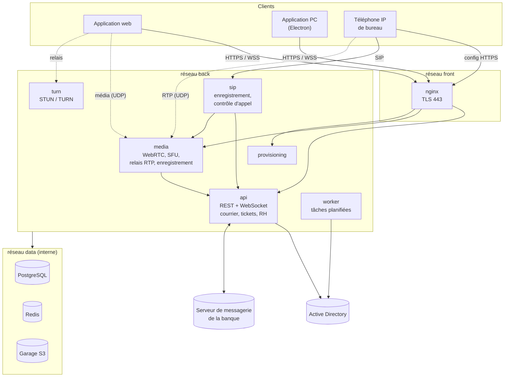

### 3.1 Les services

| Service | Langage / bibliothèque | Écoute sur | Responsabilité |
|---|---|---|---|
| **nginx** | nginx 1.27 | 443 (public) | TLS, site web (application React compilée), proxy inverse, limites de débit connexion/API, téléchargement de l'installateur |
| **api** | Go, chi | 8080 (interne) | authentification, pointage, messagerie, courrier (interne et externe), tickets, annonces, RH, audit, invitations aux réunions ; événements WebSocket |
| **media** | Go, pion | 8080 + UDP 10000-10200 | WebRTC des appels PC, SFU des réunions (jusqu'à 12), relais RTP pour les téléphones, enregistrement, partage d'écran, routage de la prise de contrôle |
| **sip** | Go, sipgo | 5060 / 5061 | enregistrement SIP et routage des appels (ne pas déranger, occupé, absent, envoi vers plusieurs appareils) |
| **turn** | Go, pion/turn | 3478, 49152-49200/udp | relais quand l'UDP vers `media` est bloqué |
| **provisioning** | Go | 8080 (interne) | configuration automatique des téléphones IP |
| **worker** | Go | — | clôture des journées oubliées à minuit, synchronisation nocturne de l'annuaire, purge selon la durée de conservation des enregistrements, initialisation des rôles et des responsables de service |
| **postgres / redis / garage** | — | interne uniquement | données, temps réel, objets |

> Le **courrier externe** sortant et entrant (file d'attente du relais SMTP, lecture IMAP) s'exécute dans le service `api`. Les **sauvegardes** sont un script (`scripts/backup.sh`), pas un service.

### 3.2 Zones réseau et ports exposés

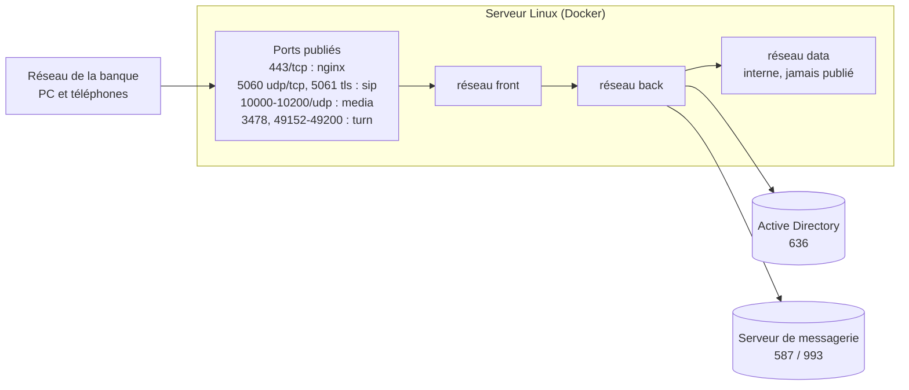

Seul `nginx` est joignable en HTTP. `postgres`, `redis` et `garage` vivent sur un réseau **interne** : ils n'ont aucune route vers l'extérieur et ne sont pas publiés. Le média temps réel ne peut pas passer par un proxy HTTP, c'est pourquoi `sip`, `media` et `turn` publient leurs propres plages de ports.

---

## 4. Flux principaux

### 4.1 La connexion est le pointage

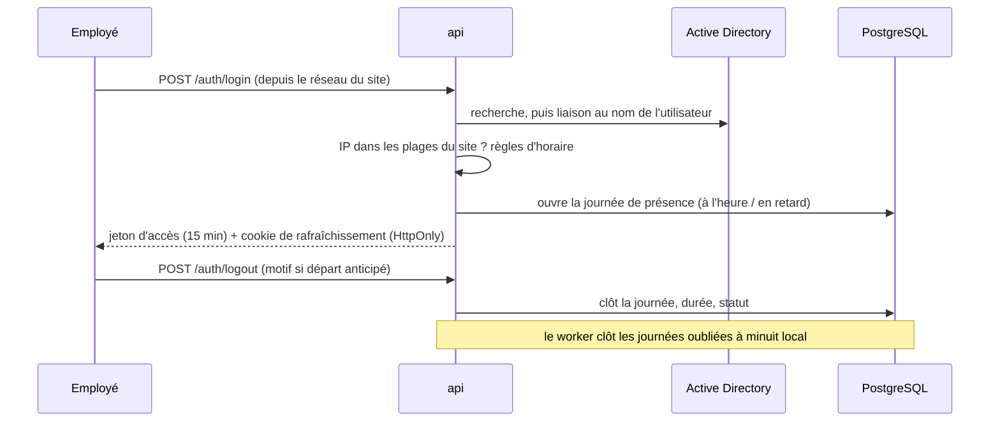

Les mots de passe ne sont jamais stockés : Active Directory est la seule autorité.

### 4.2 Événements en temps réel (messages, courrier, tickets, annonces)

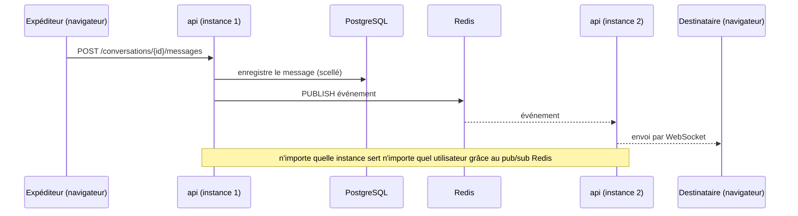

### 4.3 Un appel entre un téléphone de bureau et un PC

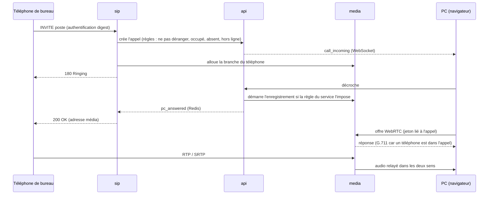

### 4.4 Une réunion vidéo (SFU)

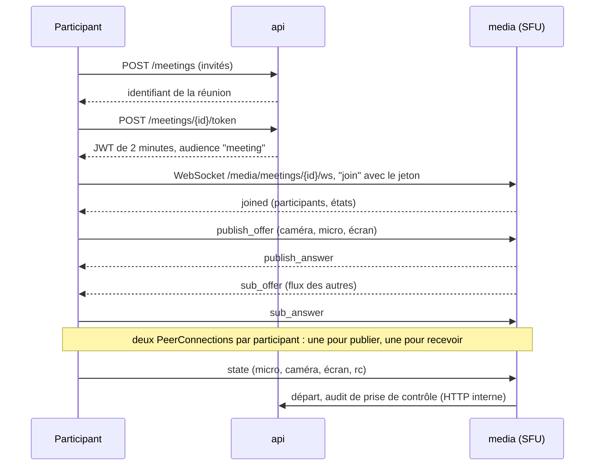

Chaque participant envoie **une seule** copie de ses flux ; le SFU les retransmet aux autres (sans mixage). Les flux se nomment `<utilisateur>:<cam|screen>`.

### 4.5 Prise de contrôle d'un écran partagé

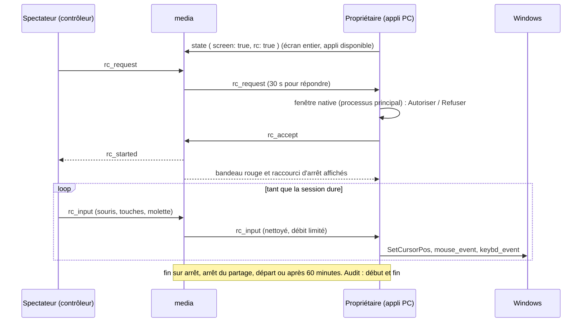

Les événements ne circulent que du **contrôleur vers le propriétaire**, uniquement pendant une autorisation acceptée, et sont bornés (coordonnées 0..1, débit limité, touche Windows bloquée).

### 4.6 Courrier externe

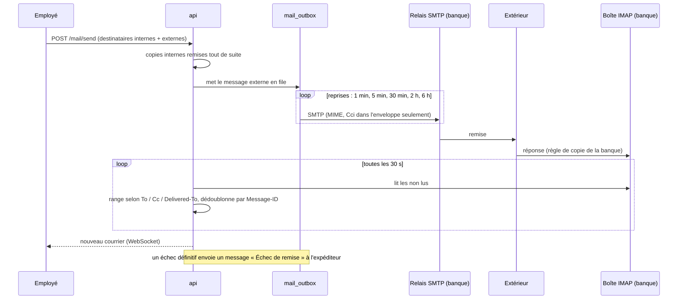

### 4.7 Cycle de vie d'un ticket

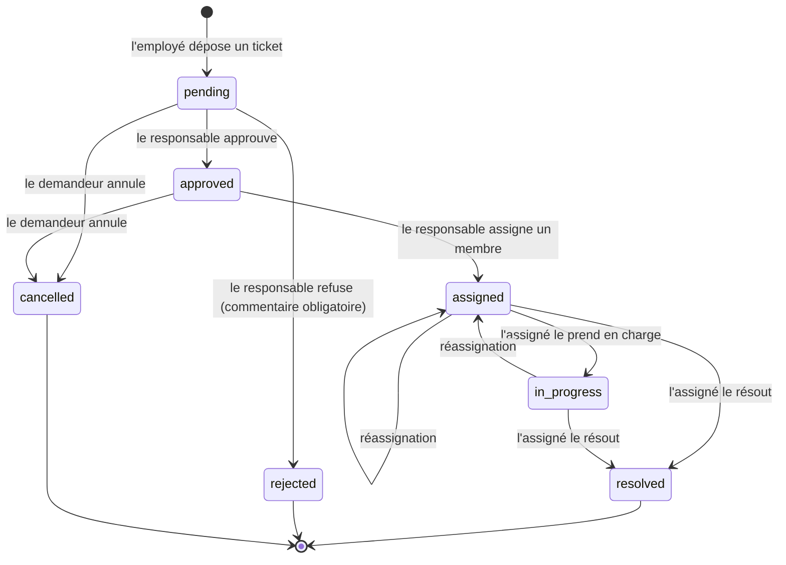

---

## 5. Données

### 5.1 Modèle de données (tables principales, par domaine)

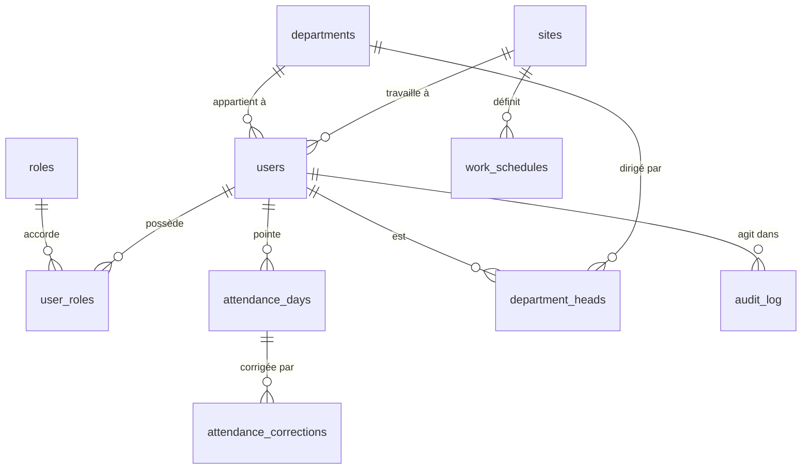

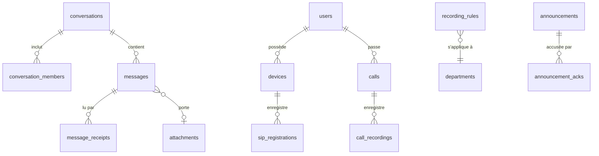

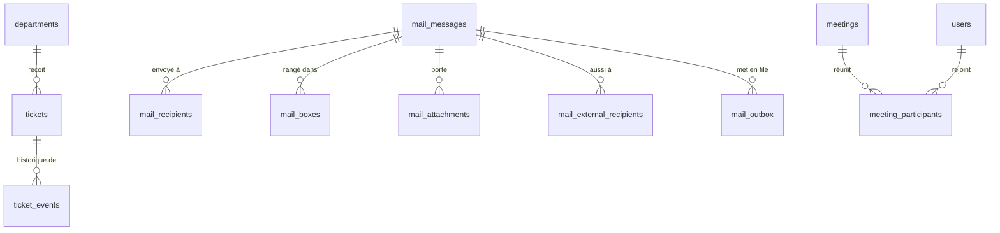

Douze migrations en avant seulement (`db/migrations/000001_init` … `000012_meetings`) construisent le schéma : utilisateurs et sites, pointage, messagerie, appels, SIP, appareils, annonces et RH, enregistrement, tickets, courrier, courrier externe, réunions.

### 5.2 Protection des données

| Donnée | Où | Protection |
|---|---|---|
| Mots de passe des employés | nulle part | non stockés (Active Directory) |
| Messages | PostgreSQL | AES-256-GCM par message, clé `MESSAGE_KEY` hors de la base |
| Objet et corps des courriers | PostgreSQL | AES-256-GCM, lié à l'identifiant du message |
| Pièces jointes, enregistrements | Garage | objets AES-256-GCM, clés `MESSAGE_KEY` / `RECORDING_KEY` |
| Secrets SIP | PostgreSQL | scellés avec `SIP_KEY`, affichés une seule fois |
| Journal d'audit | PostgreSQL | en ajout seul (des déclencheurs refusent UPDATE / DELETE / TRUNCATE) |
| Sauvegardes | copie hors serveur | chiffrées avec une phrase secrète avant de quitter le serveur |

---

## 6. Environnements

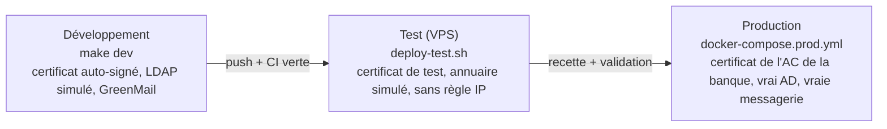

| | Développement | Test (VPS) | Production |
|---|---|---|---|
| Démarrage | `make dev` | `sh scripts/deploy-test.sh <ip>` | `docker compose -f docker-compose.yml -f docker-compose.prod.yml up -d --build --wait` |
| Fichiers compose | base + `dev` | base + `test` | base + `prod` |
| Annuaire | `ldap-mock` (20 utilisateurs de démonstration) | `ldap-mock` (mots de passe générés) | Active Directory de la banque en LDAPS |
| Courrier | GreenMail | aucun / relais si fourni | relais SMTP + boîte IMAP de la banque |
| Certificat | auto-signé (`make certs`) | auto-signé ou public | autorité interne de la banque |
| Règle réseau | plages locales | **aucune** (`ENFORCE_SITE_NETWORK=false`, les testeurs se connectent de n'importe où) | vraies plages des agences, règle active |
| Secrets | valeurs de `.env.example` | valeurs aléatoires de `gen-env.sh` | coffre-fort, remplacés avant le démarrage |

L'**application PC** se construit avec `scripts/build-desktop.ps1 -Url <serveur>` (avec `-PinServerCertificate` pour un serveur de test auto-signé) et se publie dans `downloads/` avec un `manifest.json` (version, taille, SHA-256) ; le site la propose depuis le menu du profil et la page Aide.

---

## 7. Démarche qualité

### 7.1 Pyramide de tests

| Niveau | Outil | Volume | Ce qui est vérifié |
|---|---|---|---|
| Unitaire (Go) | `go test -race` | 16 fichiers de tests | règles de pointage, cryptographie, authentification SIP, logique du SFU et de la prise de contrôle, analyse du courrier |
| Unitaire (web) | Vitest | 8 tests | fonctions utilitaires, traductions, couleurs de la charte |
| Unitaire (PC) | lanceur de tests Node | 15 tests | règles de la prise de contrôle, correspondance des touches |
| Bout en bout | scripts Node sur la vraie pile | 232 vérifications | `realtime` 22, `calls` 23, `hr` 36, `tickets` 35, `mail` 54, `mail-external` 22, `meetings` 40 |
| Charge | `scripts/load-test.sh`, tests de charge `services/e2e` | à la demande | connexions simultanées, messages, branches téléphoniques |
| Sécurité | Trivy (`scripts/scan.sh`, CI) | par image | vulnérabilités connues (un niveau CRITICAL bloque la construction) |

### 7.2 Intégration continue (aujourd'hui)

`.github/workflows/ci.yml` s'exécute à chaque push et chaque demande de fusion :

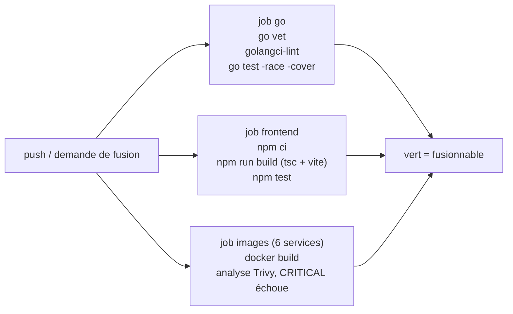

**Lacunes à combler** (recommandé) : exécuter les **tests de l'application PC** et les **scripts de bout en bout** (sur une pile démarrée dans le job), construire les **PDF de documentation**, publier l'**installateur Windows** comme pièce jointe de version, et automatiser les mises à jour de dépendances.

---

## 8. Workflow Git

### 8.1 Situation actuelle

| Élément | État |
|---|---|
| Dépôt distant | `github.com/irs269/EximPhone`, privé |
| Branches | une seule : `main` (tronc), environ 27 commits, poussés directement |
| Étiquettes / versions | aucune pour l'instant |
| CI | à chaque push et demande de fusion (§ 7.2) |
| Messages de commit | une phrase descriptive, en anglais ou en français |

C'est acceptable pour un développeur seul qui construit la première version. Pour une **équipe** et pour une **banque** (traçabilité, validation des changements), nous recommandons le GitFlow allégé ci-dessous.

### 8.2 Workflow recommandé (GitFlow allégé)

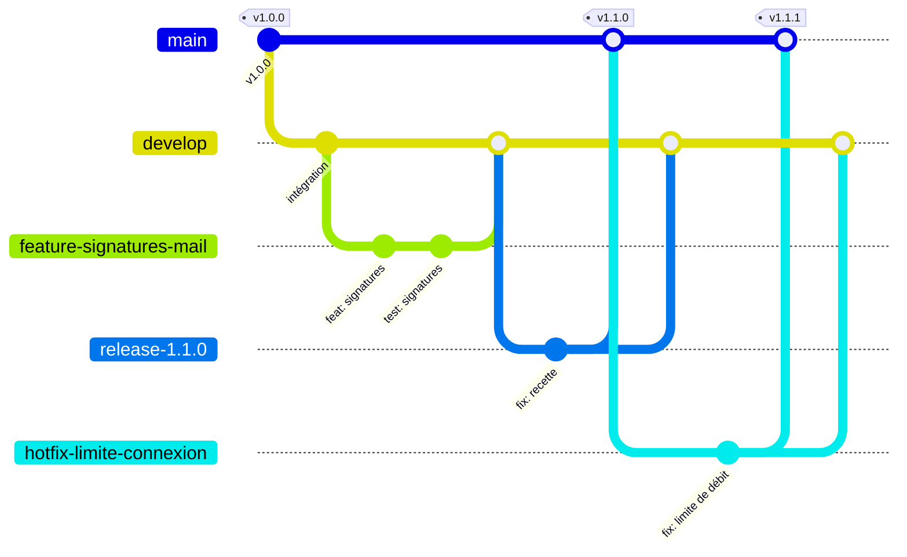

| Branche | Rôle | Créée depuis | Fusionnée dans | Déployée sur |
|---|---|---|---|---|
| `main` | ce qui tourne en **production** ; chaque commit est une version étiquetée | — | — | production |
| `develop` | intégration des fonctionnalités terminées | `main` | `release/*` | environnement de **test** (VPS) |
| `feature/<sujet>` | une fonctionnalité ou une correction | `develop` | `develop` (demande de fusion) | poste du développeur |
| `release/<x.y.z>` | gel, recette, dernières corrections | `develop` | `main` et `develop` | test, puis production |
| `hotfix/<sujet>` | correction urgente en production | `main` | `main` et `develop` | production |

**Règles**

1. **`main` et `develop` sont protégées** : pas de push direct, demande de fusion obligatoire, CI verte, **une relecture** (deux pour les zones sensibles : authentification, cryptographie, prise de contrôle, audit).
2. **Branches courtes** : une branche de fonctionnalité vit des jours, pas des semaines ; on la rebase sur `develop` avant la demande de fusion.
3. **Fusion « squash »** pour les fonctionnalités (un commit propre par fonctionnalité), **commit de fusion** pour les versions et les correctifs urgents (la version reste visible dans l'historique).
4. **Versionnement sémantique** : `vMAJEUR.MINEUR.CORRECTIF`. Les changements incompatibles (base de données, contrat d'API) incrémentent MAJEUR ; les fonctionnalités MINEUR ; les corrections CORRECTIF. On n'étiquette que sur `main`.
5. **Ne jamais réécrire l'historique publié** de `main` ou `develop`.
6. **Les secrets n'entrent jamais dans Git** (`.env` est ignoré ; `.env.example` ne contient que des valeurs factices). Un secret divulgué est révoqué, pas seulement effacé.
7. **Les changements de base de données** sont un nouveau fichier de migration numéroté ; on ne modifie jamais une migration déjà appliquée.

**Messages de commit** : Conventional Commits, en anglais : `type(périmètre): résumé`, avec `feat`, `fix`, `docs`, `test`, `refactor`, `chore`, `ci`, `perf`, `security`. Exemples : `feat(mail): external recipients through the SMTP relay`, `fix(media): release keys when the controller leaves`.

**Liste de contrôle d'une demande de fusion**

- [ ] Le changement est décrit (quoi, pourquoi) et lié à un ticket
- [ ] La CI est verte (Go, frontend, images)
- [ ] Tests ajoutés ou mis à jour (unitaires, et le script de bout en bout concerné)
- [ ] Migration ajoutée si le schéma change (en avant seulement, testée sur une copie)
- [ ] Aucun secret, aucune donnée personnelle, aucun code de débogage
- [ ] Documentation mise à jour (`docs/`, manuel si un écran a changé)
- [ ] Relecteur d'accord

### 8.3 Publier et déployer

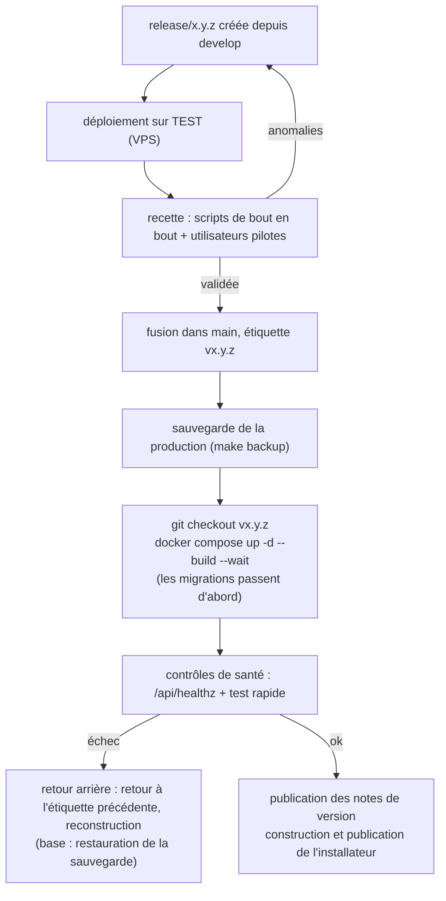

**Procédure de mise à jour sur un serveur** (une commande à la fois) :

```bash
cd ~/EximPhone && git fetch --tags && git checkout v1.1.0
sh scripts/backup.sh
docker compose -f docker-compose.yml -f docker-compose.prod.yml up -d --build --wait
curl -sk https://localhost/api/healthz
```

Les migrations sont **en avant seulement** et s'exécutent automatiquement par le service ponctuel `migrate` avant le démarrage de l'API. Un retour arrière du **code** est un retour à l'étiquette précédente ; un retour arrière de la **base** est la restauration de la sauvegarde faite avant la mise à jour : **toujours sauvegarder d'abord**.

---

## 9. Exploitation

| Sujet | Comment |
|---|---|
| Journaux | JSON structuré (`slog`) sur la sortie standard de chaque conteneur ; `docker compose logs <service>` |
| Santé | `/healthz` sur chaque service ; contrôles de santé Docker ; `docker compose ps` |
| Métriques | point d'accès `/metrics` sur chaque service Go (à collecter par la supervision de la banque) |
| Sauvegardes | `scripts/backup.sh` (export chiffré + archive du stockage d'objets) ; `scripts/restore-test.sh` restaure dans une base temporaire et compare les volumes ; copie hors serveur chaque jour |
| Secrets | `.env` généré par `scripts/gen-env.sh` ; clés de chiffrement (`MESSAGE_KEY`, `RECORDING_KEY`, `SIP_KEY`) conservées **hors** du serveur et des sauvegardes |
| Mises à jour | § 8.3 ; mises à jour de dépendances relues et passées dans la CI et Trivy |
| Capacité | un serveur (4 vCPU, 8 Go) pour quelques centaines d'utilisateurs ; le média est la seule partie sensible au processeur et à la bande passante |

---

## 10. Organisation du dépôt

```
EximPhone/
├── services/              module Go (un seul go.mod) : api, media, sip, turn, provisioning, worker
│   ├── pkg/               code partagé : pointage, crypto, annuaire, SDP, auth SIP, TURN, base serveur
│   ├── e2e/               tests Go de bout en bout et de charge
│   └── Dockerfile         une seule recette multi-étapes pour tous les services (build-arg SERVICE)
├── frontend/              application web React + TypeScript (compilée dans l'image nginx)
├── desktop/               application PC Electron : processus principal, prise de contrôle, pilote Windows, tests
├── db/migrations/         migrations SQL numérotées, en avant seulement (000001 … 000012)
├── db/seed/               données de pointage de démonstration
├── nginx/                 modèles (TLS, proxy, limites de débit) et certificats
├── ldap-mock/             annuaire de démonstration (20 utilisateurs, dev et test seulement)
├── ops/garage/            image du stockage d'objets
├── scripts/               sauvegarde, test de restauration, deploy-test, charge, installateur, docs, analyse
├── tests/e2e/             scripts de recette de bout en bout (Node)
├── docs/                  architecture, ADR, déploiement, guides de modules, documentation fr/ et en/
├── brand/                 logos et polices
├── docker-compose*.yml    base + surcharges dev / test / prod
├── Makefile               dev, up, down, logs, migrate, seed, test, certs, backup
└── .github/workflows/     intégration continue
```

---

## 11. Décisions d'architecture (ADR)

| ADR | Décision | Pourquoi |
|---|---|---|
| 0001 | **Garage** (compatible S3) plutôt que MinIO pour le stockage d'objets | les images officielles de MinIO n'étaient plus téléchargeables ; tout le code parle l'API S3, le stockage est donc remplaçable |
| 0002 | Média **relayé par notre serveur**, **G.711** (sans transcodage) dès qu'un téléphone est dans l'appel | l'enregistrement, le raccordement SIP et la traversée de NAT ne sont possibles qu'avec un relais |
| 0003 | **Authentification digest** SIP, mots de passe **scellés** (AES-256-GCM) | les téléphones reçoivent leur mot de passe dans les fichiers de configuration ; il ne doit jamais être stocké en clair |
| 0004 | **Chiffrement au repos** dans l'application, clés distinctes selon l'usage | un export de base ou de stockage ne doit révéler ni messages, ni pièces jointes, ni enregistrements |
| 0005 | Événements temps réel par **WebSocket et pub/sub Redis** | mises à jour en moins d'une seconde et plus d'une instance api |
| 0006 | **Le pointage est la connexion**, avec contrôle du réseau | données de pointage fiables sans système de badge séparé |

Les textes complets sont dans `docs/adr/`.

---

## 12. Limites techniques connues

| Limite | Impact | Réponse prévue |
|---|---|---|
| Le stockage d'objets tourne sur **un seul nœud** (réplication 1) | perdre le volume fait perdre pièces jointes et enregistrements | disposition répliquée ou sauvegardes quotidiennes du volume (§ 9) |
| Les clés de chiffrement sont dans l'environnement ; **pas de tâche de rotation** des clés | changer une clé impose un rechiffrement à la main | coffre-fort / KMS derrière le type `Box` existant, plus une tâche de rechiffrement |
| **Pas de chiffrement de bout en bout** (le serveur peut lire les messages par conception) | nécessaire pour la conformité et l'enregistrement | choix documenté (ADR 0004) |
| Le digest SIP accepte encore **MD5** pour les anciens téléphones | plus faible pour les appareils anciens | désactiver dès que le parc supporte SHA-256 ; utiliser SIP sur TLS |
| **Redis** est une dépendance du temps réel | s'il tombe, messagerie et appels s'arrêtent ; pointage et historique continuent | haute disponibilité de Redis en production |
| Les messages ne se cherchent pas en SQL (ils sont chiffrés) | la recherche déchiffre les derniers messages dans l'api | acceptable à cette échelle ; à revoir si les volumes croissent |
| La prise de contrôle est **réservée à Windows** | pas de propriétaires macOS / Linux | hors périmètre de la première version |

---

## 13. Glossaire

| Terme | Signification |
|---|---|
| **SFU** | *Selective Forwarding Unit* : serveur qui reçoit le flux de chaque participant une seule fois et le retransmet aux autres |
| **WebRTC** | standard des navigateurs pour l'audio et la vidéo en temps réel |
| **SIP / RTP / SRTP** | signalisation téléphonique / transport du média / transport chiffré du média |
| **STUN / TURN** | aides qui permettent au média de traverser pare-feu et NAT |
| **DTLS-SRTP** | le chiffrement utilisé par WebRTC pour le média |
| **LDAP / LDAPS** | protocole d'annuaire (Active Directory) / sa version chiffrée |
| **JWT** | jeton signé portant l'identité de l'utilisateur et sa durée de validité |
| **RBAC** | contrôle d'accès fondé sur les rôles |
| **ADR** | fiche de décision d'architecture |
| **Migration en avant seulement** | modification de la base qu'on ne modifie ni n'annule jamais ensuite ; les corrections sont de nouvelles migrations |
| **Distroless** | image de conteneur minimale, sans shell ni gestionnaire de paquets, qui réduit la surface d'attaque |
