# Exim Connect — Manuel d'utilisation

*Guide pas à pas pour les collaborateurs d'Exim Bank. Les captures proviennent d'un environnement de démonstration : les noms et les données sont fictifs.*

---

## 1. Pour commencer

### 1.1 Ouvrir Exim Connect

Exim Connect s'utilise de deux façons, avec le même compte :

- **dans un navigateur** (Chrome, Edge…), à l'adresse communiquée par la DSI ;
- **avec l'application PC** (Windows), qui s'ouvre comme un logiciel ordinaire. Elle est **nécessaire pour la prise de contrôle à distance** (voir § 5.5). Pour l'installer : menu de votre profil (en bas à gauche) → **Télécharger et installer**, ou page **Aide**.

### 1.1 bis Être connecté automatiquement dans l'application PC

Vous n'avez **pas besoin de retaper votre mot de passe** dans l'application PC si vous êtes déjà connecté sur le site :

- **Depuis le site** : dans le menu du profil ou la page **Aide**, cliquez sur **Ouvrir dans l'application PC**. Windows peut demander l'autorisation d'ouvrir Exim Connect : acceptez. L'application s'ouvre avec votre session.
- **Depuis l'application** : sur l'écran de connexion, cliquez sur **Se connecter avec mon navigateur**. Le navigateur s'ouvre ; si vous y êtes déjà connecté, vous revenez dans l'application connecté.
- **Juste après l'installation** : au tout premier démarrage de l'application, le navigateur s'ouvre une fois pour faire cela automatiquement.

Ce mode ne crée **pas de nouveau pointage** : votre arrivée reste celle de votre première connexion de la journée. Si vous avez pointé votre départ entre-temps, il faut de nouveau saisir votre mot de passe.

### 1.2 Se connecter

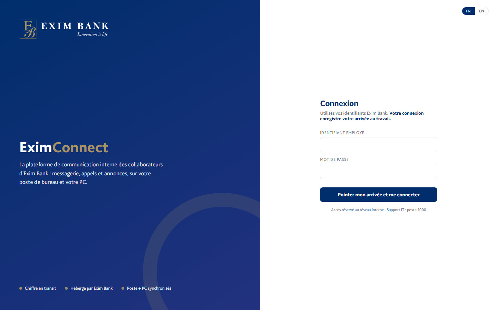

Saisissez vos **identifiants Exim Bank** (les mêmes que pour votre ordinateur). Les boutons **FR / EN**, en haut, changent la langue.

> **Important : la connexion est votre pointage d'arrivée.** Elle n'est acceptée que depuis le **réseau interne de la banque**. Depuis l'extérieur, un message vous indique que le pointage n'est pas possible.

### 1.3 Votre arrivée est enregistrée

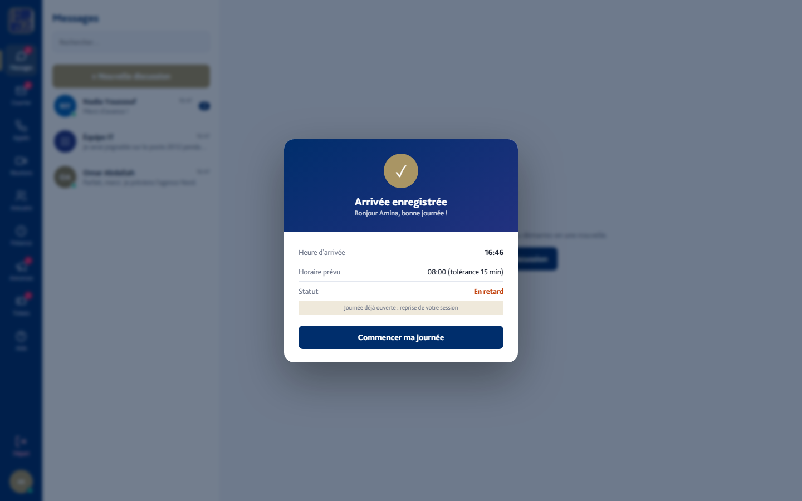

Une fenêtre confirme l'**heure d'arrivée**, l'**horaire prévu** (ici 8 h 00, avec 15 minutes de tolérance) et votre **statut** (« À l'heure » ou « En retard »). Cliquez sur **Commencer ma journée**.

### 1.4 Les annonces urgentes

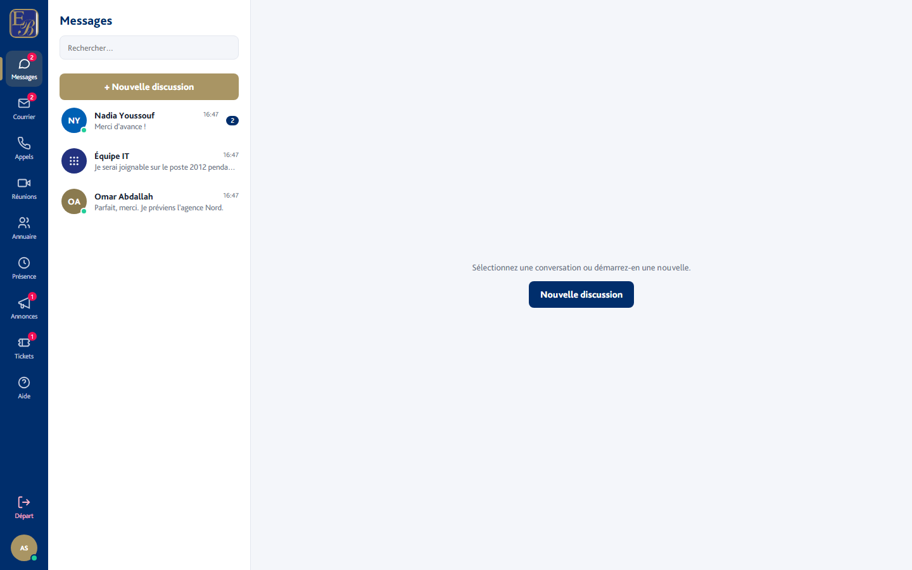

Si la direction ou la communication publie une **annonce urgente**, elle s'affiche au milieu de l'écran jusqu'à ce que vous cliquiez sur **Accuser réception**. Cela permet à l'émetteur de savoir qui l'a lue.

### 1.5 Se repérer dans l'application

La **barre bleue à gauche** donne accès à tous les modules :

| Bouton | À quoi il sert |
|---|---|
| **Messages** | discussions instantanées, individuelles ou en groupe |
| **Courrier** | courriel interne et externe |
| **Appels** | téléphone : appeler un collègue ou un numéro |
| **Réunions** | réunions vidéo, partage d'écran, prise de contrôle |
| **Annuaire** | retrouver un collègue, voir sa présence |
| **Présence** | votre pointage et son historique |
| **Annonces** | notes de service et circulaires |
| **Tickets** | demandes adressées aux services (informatique, RH…) |
| **Équipe** | tableau de bord RH ou manager (selon votre rôle) |
| **Audit** | journal de traçabilité (auditeurs uniquement) |
| **Aide** | réponses rapides, contact du support, application PC |
| **Départ** | pointage de départ et déconnexion |

Les **pastilles rouges** indiquent ce qui attend votre attention (messages non lus, courriers, annonces, tickets).

### 1.6 Votre statut, la langue et l'application PC

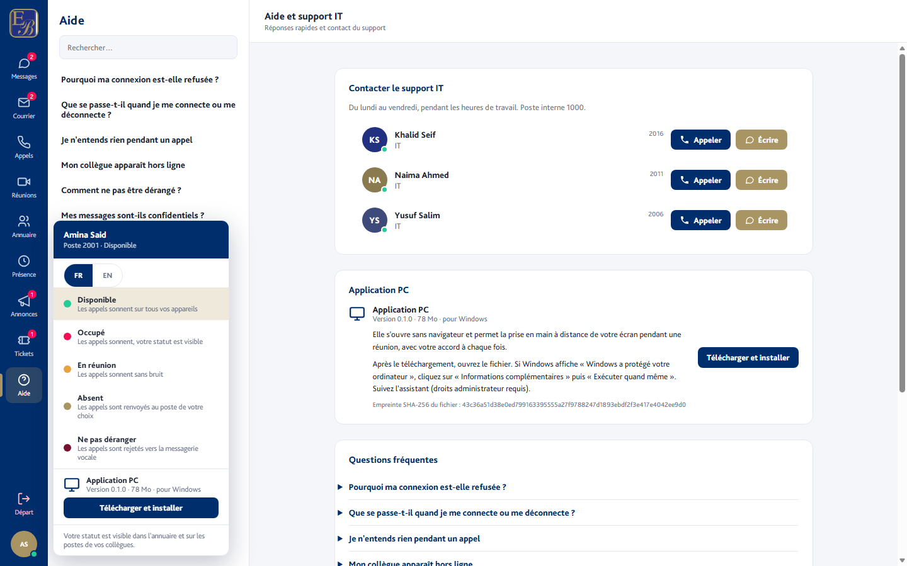

Cliquez sur votre **pastille ronde en bas à gauche** :

- **FR / EN** : change la langue de l'interface ;
- **Disponible, Occupé, En réunion, Absent, Ne pas déranger** : votre statut, visible de tous dans l'annuaire. Il décide aussi de la façon dont vos appels sonnent ;
- **Télécharger et installer** : installe l'application PC.

---

## 2. Messages

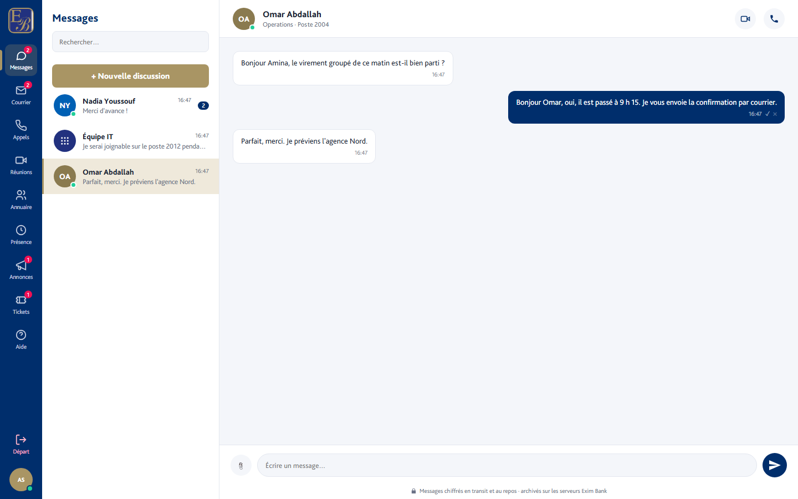

- **Liste des discussions** à gauche, conversation à droite. Un **point vert** indique qu'une personne est en ligne.
- Écrivez dans la zone du bas puis envoyez avec **Entrée** ou le bouton rond. Le trombone joint un **fichier**.
- Les deux icônes en haut à droite lancent un **appel vidéo** ou un **appel audio** avec la personne.
- La barre **Rechercher** (en haut à gauche) retrouve un message dans toutes vos discussions.
- Les messages sont **chiffrés** et conservés sur les serveurs de la banque.

### Discussion de groupe

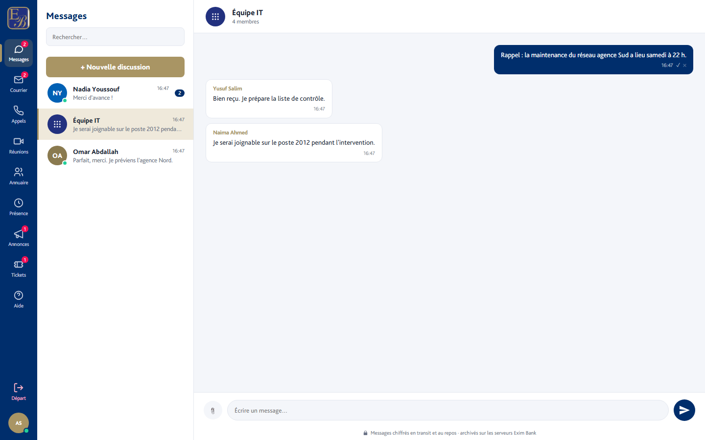

### Démarrer une discussion

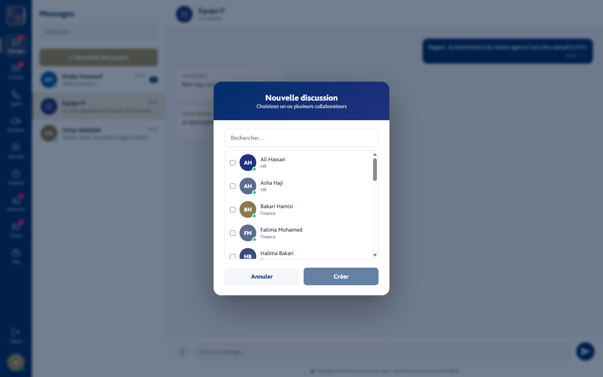

Cliquez sur **+ Nouvelle discussion**, choisissez un collègue (discussion individuelle) ou plusieurs collègues et un **nom de groupe**.

---

## 3. Courrier

Le courrier fonctionne entre collègues, et peut aussi **écrire à des adresses extérieures** si la banque a activé cette option (voir la feuille de route).

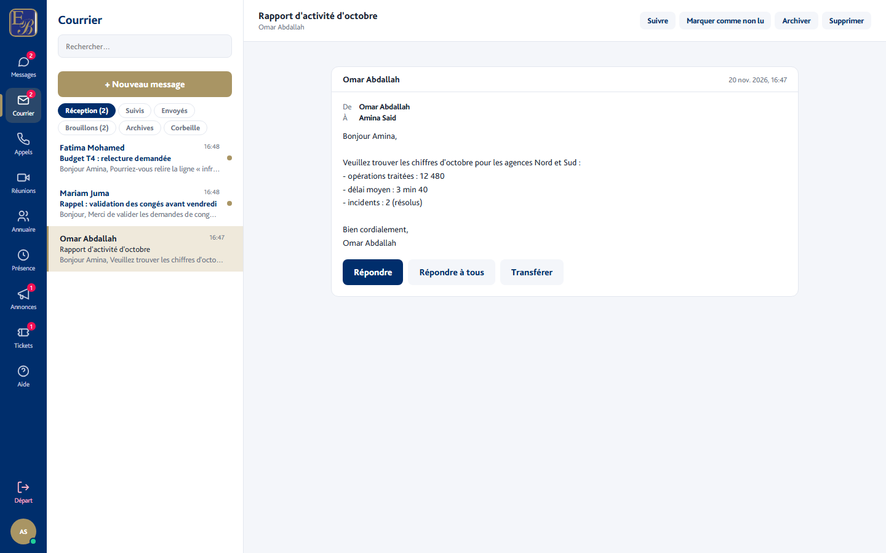

- Dossiers : **Réception, Suivis (marqués d'une étoile), Envoyés, Brouillons, Archives, Corbeille**.
- Les messages sont regroupés par **conversation** : une réponse reste dans le même fil.
- En haut à droite du message : **Répondre**, **Répondre à tous**, **Transférer**, **Archiver**, **Supprimer**.
- La zone **Rechercher** cherche dans l'objet, le texte, l'expéditeur et les destinataires.

### Écrire un message

Cliquez sur **+ Nouveau message**.

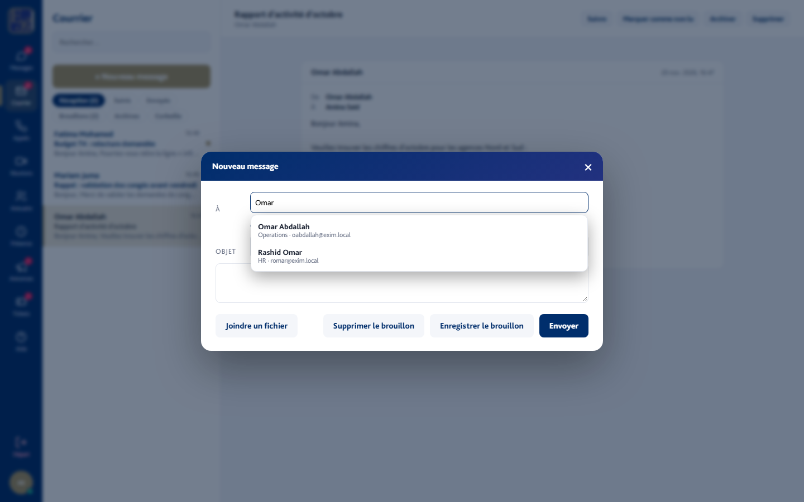

1. Dans **À**, tapez quelques lettres d'un nom : la liste propose les collègues. Cliquez sur le bon.
2. Pour une **adresse extérieure**, tapez l'adresse complète puis appuyez sur **Entrée**.
3. **Cc / Cci** : copie visible ou copie cachée. Les destinataires en Cci ne sont jamais visibles des autres.
4. Renseignez **l'objet** et le message.
5. **Joindre un fichier** : jusqu'à 10 fichiers de 20 Mo (25 Mo au total). Les programmes exécutables (.exe, .bat, .js…) sont refusés par sécurité.

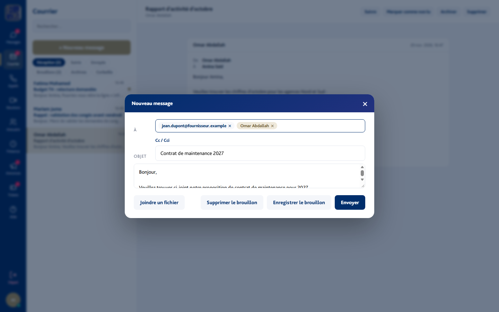

Le message est **enregistré automatiquement en brouillon** quelques secondes après votre dernière frappe. **Envoyer** l'envoie, **Supprimer le brouillon** l'abandonne.

> Une adresse extérieure apparaît avec la mention **Externe**. Si l'envoi échoue, un message « Échec de remise » arrive dans votre réception.

---

## 4. Appels

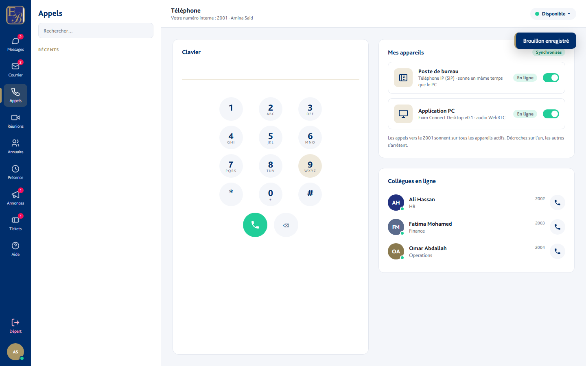

- Votre **numéro interne** est affiché en haut (ici 2001).
- Composez un numéro au **clavier**, ou cliquez sur l'icône téléphone d'un collègue (annuaire, messages).
- **Vos appareils** : un appel vers votre numéro sonne **en même temps** sur le PC et sur le **téléphone IP de votre bureau**. Vous répondez où vous voulez.
- Les appels récents sont listés à gauche.
- Votre **statut** (Occupé, En réunion, Ne pas déranger) décide si le téléphone sonne.

---

## 5. Réunions

### 5.1 La page Réunions

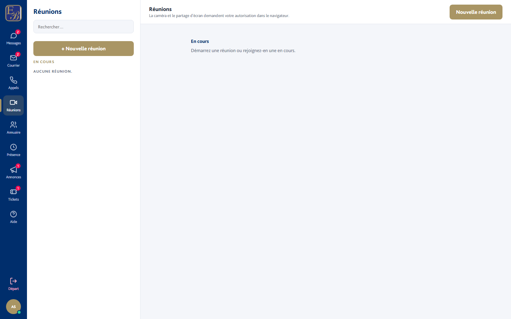

Les réunions **en cours** auxquelles vous êtes invité apparaissent à gauche : un clic pour rejoindre. La caméra et le micro demandent votre **autorisation** dans le navigateur la première fois.

### 5.2 Démarrer une réunion

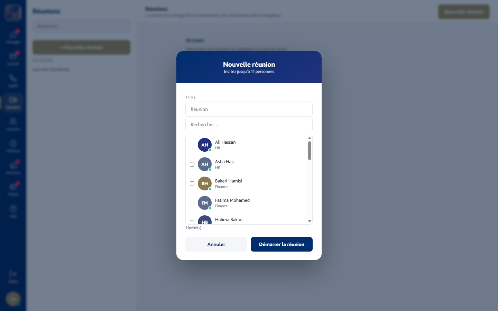

1. **+ Nouvelle réunion**.
2. Donnez un **titre** (facultatif).
3. Cochez les **invités** (jusqu'à 11 personnes, soit 12 avec vous). Utilisez la zone de recherche pour les trouver.
4. **Démarrer la réunion**. Les invités reçoivent une alerte et rejoignent d'un clic. Vous pouvez en **inviter d'autres** ensuite avec le bouton **Inviter**.

### 5.3 Dans la salle

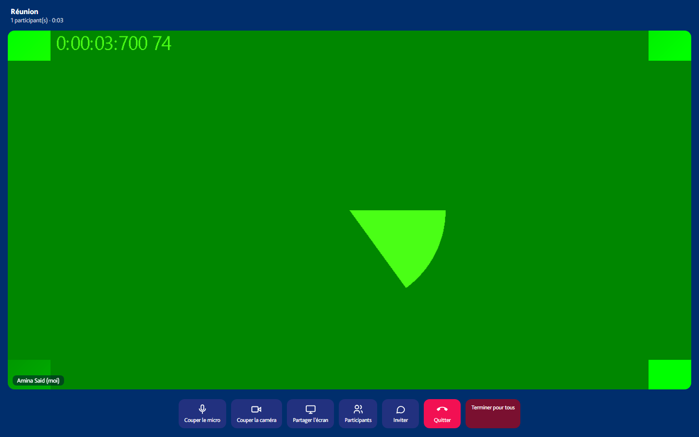

Les boutons du bas :

| Bouton | Action |
|---|---|
| **Couper le micro** | coupe/réactive votre micro |
| **Couper la caméra** | coupe/réactive votre caméra |
| **Partager l'écran** | montre votre écran, ou une fenêtre, aux participants |
| **Participants** | liste des personnes présentes |
| **Inviter** | ajoute des collègues |
| **Quitter** | vous sortez, la réunion continue |
| **Terminer pour tous** | (organisateur) ferme la réunion pour tout le monde |

*Dans cette capture, l'image verte est une caméra de test.* Un **appel vidéo à deux** se lance aussi depuis une discussion (icône caméra).

### 5.4 Partager son écran

Cliquez sur **Partager l'écran**. Dans l'**application PC**, une fenêtre vous propose :

- **Écrans** : votre écran entier (celui-ci peut être contrôlé à distance) ;
- **Fenêtres** : une seule fenêtre (elle ne peut pas être contrôlée).

Choisissez, puis cliquez sur **Partager**. Un bandeau jaune vous confirme si la **prise de contrôle** est possible. **Arrêter le partage** à tout moment avec le même bouton.

### 5.5 Prendre le contrôle de l'écran d'un collègue

*Réservé aux participants qui utilisent l'**application PC** (celui qui partage) et aux collègues qui regardent.*

**Pour demander le contrôle :**

1. Votre collègue partage son **écran entier** depuis l'application PC.
2. Passez la souris sur son écran partagé : le bouton **Demander le contrôle** apparaît. Cliquez dessus.
3. Attendez : une fenêtre s'ouvre **chez votre collègue**, qui doit cliquer sur **Autoriser**. S'il refuse ou ne répond pas dans les 30 secondes, la demande s'arrête.
4. Une fois accepté, un cadre doré entoure l'écran. Vous pouvez **déplacer la souris, cliquer, faire défiler, taper au clavier**. Une barre en haut de l'écran offre **Plein écran** et **Arrêter le contrôle**.

**Pour accepter (celui dont on prend le contrôle) :**

1. Une fenêtre vous demande si vous autorisez *« X demande à prendre le contrôle de votre écran »*. Ne cliquez sur **Autoriser** que si **vous connaissez la personne et attendiez la demande**. Le bouton par défaut est **Refuser**.
2. Pendant le contrôle, un **bandeau rouge** reste en haut de votre écran. Vous pouvez **arrêter à tout moment** avec son bouton ou avec le raccourci **Ctrl + Alt + Maj + X**.
3. Le contrôle s'arrête aussi tout seul au bout d'**une heure**, ou dès que vous arrêtez le partage.

**À savoir :**
- La touche **Windows** n'est jamais transmise, et l'écran de verrouillage, les fenêtres de contrôle de compte (UAC) et **Ctrl+Alt+Suppr** ne peuvent pas être contrôlés.
- Les frappes tiennent compte de **la disposition du clavier** de celui qui est contrôlé : AZERTY ou QWERTY, cela fonctionne.
- Chaque début et fin de contrôle est **enregistré** dans le journal d'audit.

---

## 6. Annuaire

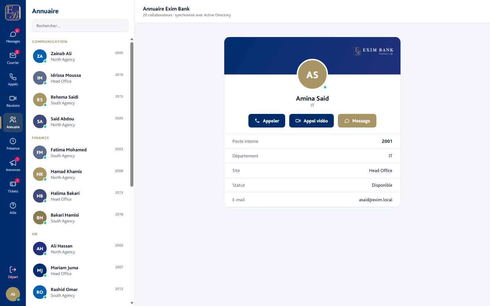

Tous les collègues, classés par **service**, avec leur **poste interne**, leur **site** et leur **statut** de présence. Cliquez sur un nom pour **écrire, appeler ou démarrer une visio**.

---

## 7. Présence

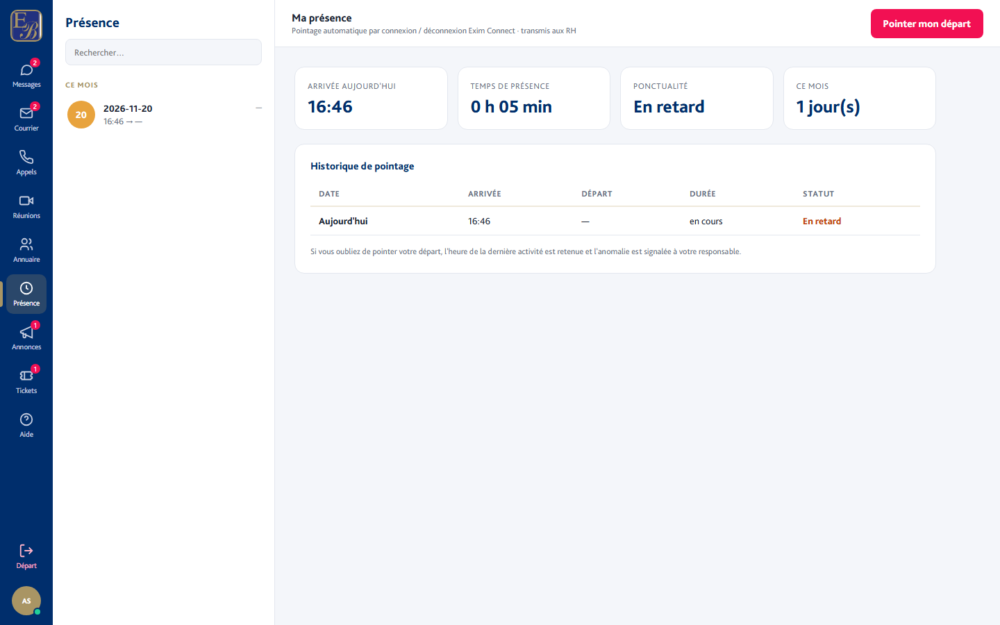

Cette page montre votre **heure d'arrivée**, votre **temps de présence** du jour, votre **ponctualité** et l'**historique** du mois. Rien à saisir : le pointage se fait **à la connexion et à la déconnexion**.

### Pointer son départ

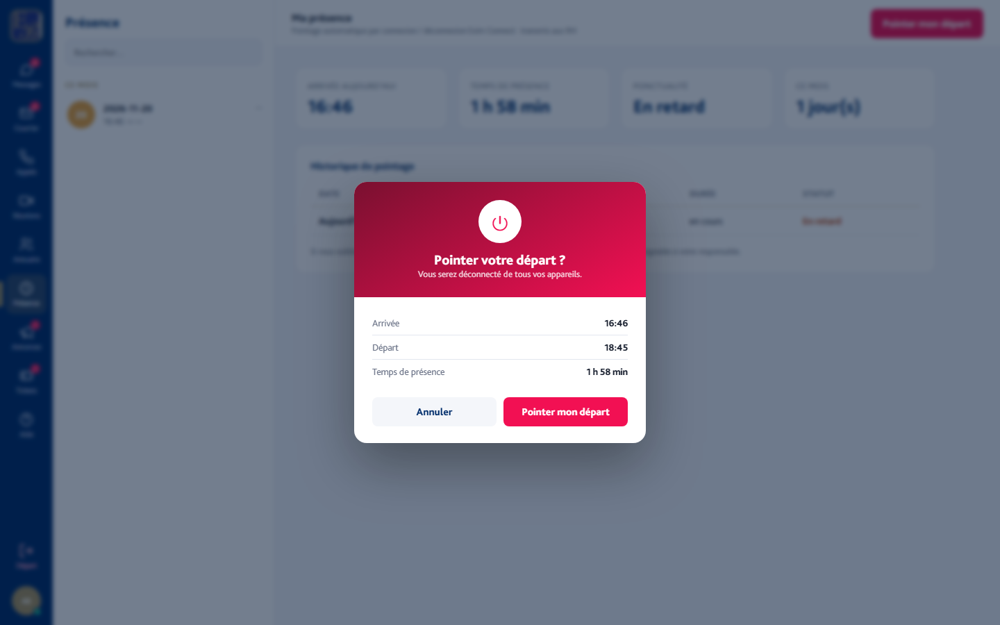

Cliquez sur **Pointer mon départ** (ou sur **Départ** dans la barre). Une fenêtre résume l'arrivée, le départ et la durée. **Vous êtes déconnecté de tous vos appareils.**

- Si vous partez **avant l'heure de fin** (par défaut 17 h 00), un **motif** est demandé : votre responsable le validera.
- Si vous oubliez de pointer, le système **clôt la journée** à minuit avec l'heure de votre dernière activité, et l'anomalie est signalée à votre responsable.

---

## 8. Annonces

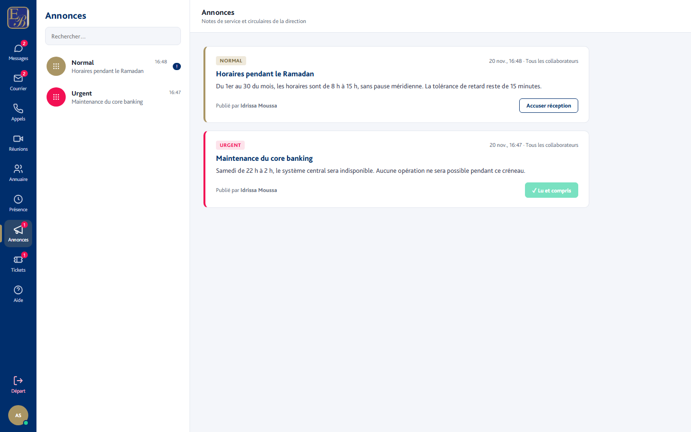

Les **notes de service et circulaires** de la direction, de la communication et des RH. Une **pastille rouge** signale les annonces que vous n'avez pas encore lues. Les annonces **urgentes** s'ouvrent en fenêtre (voir § 1.4).

---

## 9. Tickets : demandes aux services

Un **ticket** est une demande adressée à un service (informatique, RH, finance…). Le **responsable du service** l'approuve ou le refuse, puis il l'**assigne à un membre de son équipe**, qui le traite.

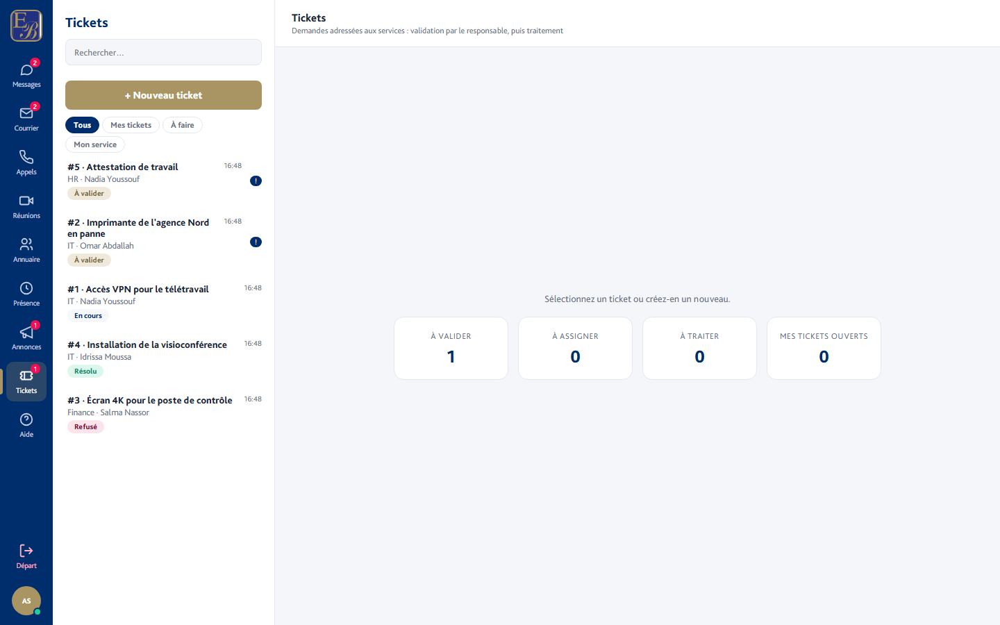

Le menu de la liste : **Tous**, **Mes tickets**, **À faire** (ce que vous devez traiter ou valider), **Mon service**. Les étiquettes de couleur donnent l'état : *À valider, Approuvé · à assigner, Assigné, En cours, Résolu, Refusé, Annulé*.

### Faire une demande

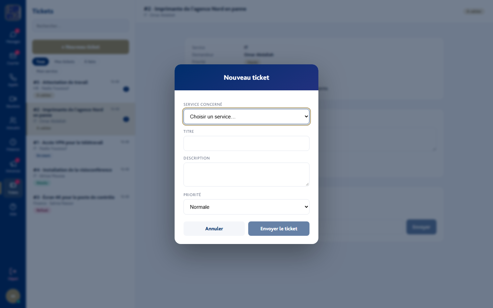

1. **+ Nouveau ticket**.
2. Choisissez le **service** concerné.
3. Donnez un **titre**, une **description** claire et une **priorité**.
4. Envoyez. Le responsable est prévenu immédiatement. Vous suivez l'avancement dans **Mes tickets**, avec l'historique complet.

### Si vous êtes le responsable d'un service

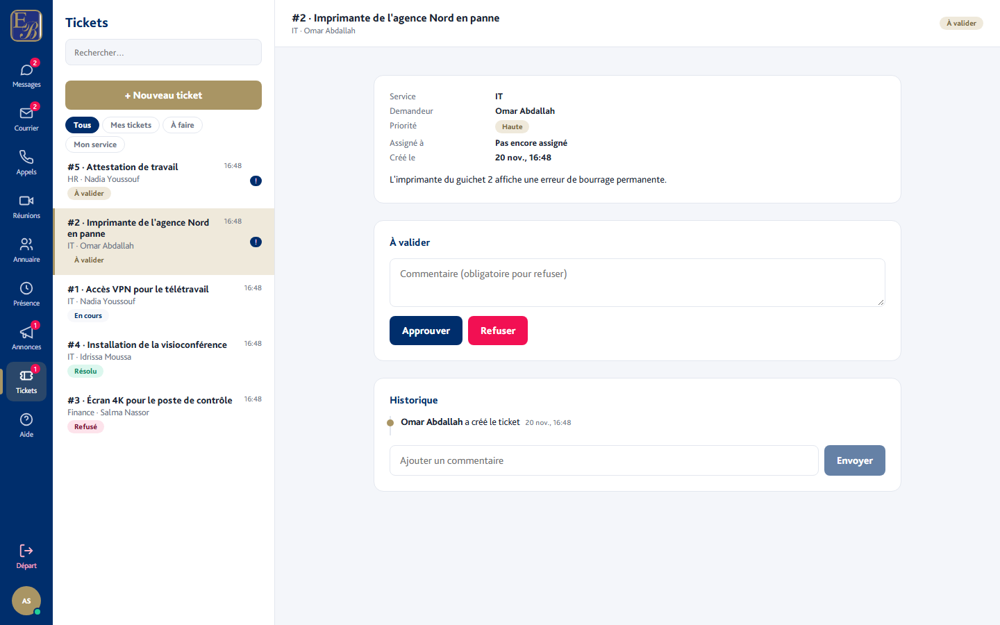

Ouvrez un ticket **À valider** :

- **Approuver** : (commentaire facultatif) le ticket passe à l'état *Approuvé* ; **Assignez-le** ensuite à un membre de votre équipe.
- **Refuser** : un **commentaire est obligatoire** (le demandeur doit comprendre pourquoi).

### Si on vous assigne un ticket

Ouvrez-le : **Prendre en charge** (état *En cours*), puis **Marquer comme résolu** avec un commentaire quand c'est fait. Le demandeur peut **annuler** son ticket tant qu'il n'est pas traité, et un responsable peut **réassigner** un ticket en cours.

---

## 10. Équipe : tableau de bord RH et manager

*Visible seulement pour les rôles RH et manager.*

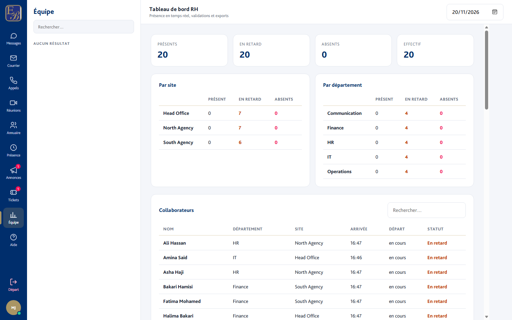

- En haut : **présents, en retard, absents, effectif** du jour (choisissez la date en haut à droite).
- **Par site** et **par service** : la répartition.
- **Collaborateurs** : une ligne par personne, avec arrivée, départ et statut.
- Le **responsable** voit son équipe. Les **RH** voient tout le monde, **valident les départs anticipés**, **corrigent un pointage** (avec un motif écrit d'au moins 5 caractères, l'ancienne valeur est conservée) et **exportent le fichier du mois** (Excel ou CSV).

> Un jour sans pointage compte comme absence : le samedi, le dimanche et les jours fériés, tout le monde apparaît donc absent (aucun calendrier de jours fériés n'est encore géré).

---

## 11. Audit

*Visible seulement pour le rôle auditeur.*

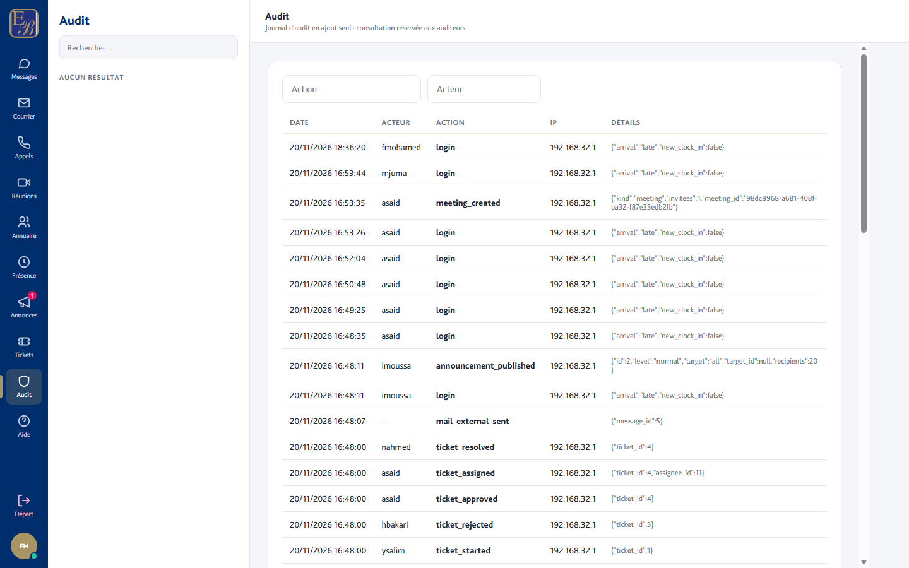

Le **journal en ajout seul** : connexions, déconnexions, rôles modifiés, corrections de pointage, envois de courrier (sans leur contenu), débuts et fins de prise de contrôle… Il **ne peut ni être modifié ni être effacé**. Chaque consultation est elle-même enregistrée.

---

## 12. Aide

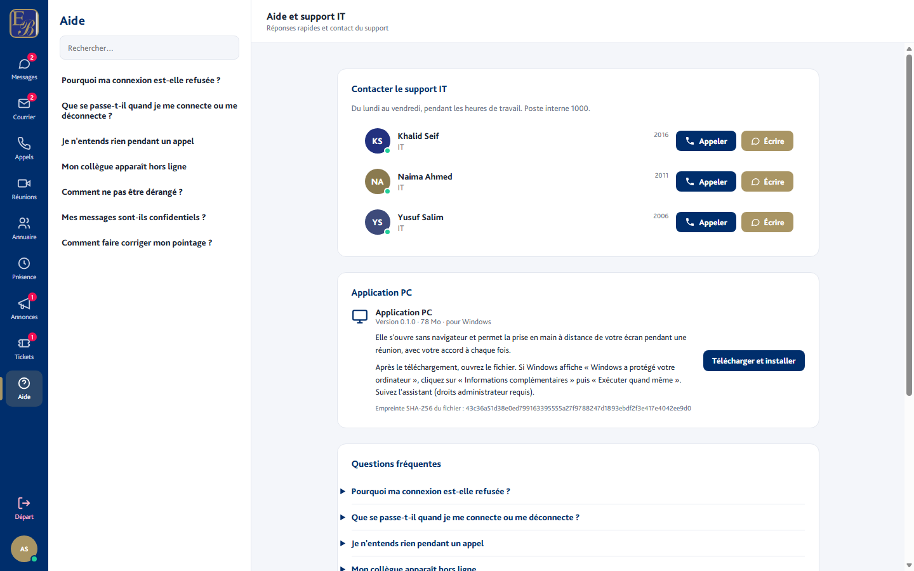

- **Contacter le support IT** : appelez ou écrivez en un clic à l'un des membres du support.
- **Application PC** : version actuelle et bouton **Télécharger et installer**. Après le téléchargement, ouvrez le fichier. Si Windows affiche « Windows a protégé votre ordinateur », cliquez sur **Informations complémentaires**, puis **Exécuter quand même**, et suivez l'assistant (droits administrateur requis). L'empreinte du fichier est indiquée pour que la DSI la vérifie.
- **Questions fréquentes** : réponses aux problèmes courants.

### Dépannage rapide

| Problème | Que faire |
|---|---|
| « Le pointage n'est possible que depuis le réseau interne » | Vous êtes hors du réseau de la banque. Connectez-vous depuis le bureau (ou le VPN s'il est ouvert). |
| Je n'entends rien pendant un appel | Vérifiez le micro et les haut-parleurs choisis dans le navigateur ou dans Windows, puis rechargez la page. |
| Le bouton **Demander le contrôle** n'apparaît pas | Votre collègue doit utiliser **l'application PC**, partager son **écran entier** (pas une fenêtre), et vous voir dans la réunion. |
| Mon collègue apparaît hors ligne | Il n'est pas connecté, ou son statut est « Ne pas déranger ». |
| La page ne se met pas à jour | Actualisez avec **Ctrl + F5**. |

---

## 13. Bonnes pratiques de sécurité

- **Ne partagez jamais votre mot de passe.** Personne, y compris la DSI, ne vous le demandera.
- **N'autorisez une prise de contrôle que si vous attendez la demande** et connaissez la personne. En cas de doute, **refusez**, puis appelez la personne pour vérifier.
- Pendant un partage d'écran, **fermez ce que vous ne voulez pas montrer** (courriels, documents confidentiels).
- **Verrouillez** votre poste (Windows + L) quand vous vous absentez.
- Signalez tout comportement étrange à la DSI (poste interne 1000).
